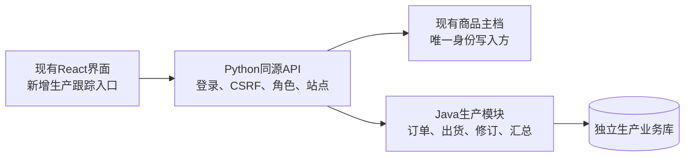

# 生产订单与实际出货跟踪最小版本实施方案

编制日期：2026-10-08。最近更新：2026-10-15。文档修订：v1.9（不是应用版本号）。用户已确认“只用预计订单表和实际出货表”的首版业务范围；本次在7.6.4补齐商品建档、待归属与审核、批量维护的衔接实施方案，沿用7.6.2／7.6.3及其已有成果，保留原MVP范围及历史交付。实际实施进度只见执行卡。

本方案已正式纳入[总主计划第2节“首批实施子计划”](2026-09-14-current-release-and-java-evolution-roadmap.md#production-order-shipment-plan)，并沿用[供应链演进计划](2026-09-17-production-inventory-fba-evolution-plan.md)的后续演进方向。第8节任务一对应主计划顺序5，任务二／三对应6a，任务四对应6b；后续关联归顺序7，完工／入库／库存等扩展归顺序8。当前版本、授权与下一动作仍以[计划索引执行卡](../../workflow/project-plan-index.md#production-order-shipment-current)为准。本稿取代旧首批“必须先有完工、入库、期初和库存”的范围，不重开旧Python实施计划，不自动启动代码、真实数据接入、迁移或部署。

## 文档导航与版本说明

| 查询目的 | 阅读位置 |
| --- | --- |
| 解决内部展示SKU与Amazon Seller SKU重复维护 | [7.6.2统一正式SKU与报表关联实施方案](#unified-sku-implementation-plan)，含数据模型、任务、兼容、验证与独立虚构交付；实时状态见当前执行卡 |
| 沿用亚马逊商品清单并以官方报表核对ASIN/FNSKU | [7.6.3商品清单与官方标识核对实施方案](#amazon-listing-asin-reconciliation-plan)，包含原表适配、字段权威、差异处理、批准一致性、后续变化与验收；实际状态见执行卡 |
| 简化商品建档、待处理与批量维护并补齐遗漏 | [7.6.4三个入口衔接实施方案](#catalog-workflow-entry-integration-plan)，覆盖统一待办、来源与候选关系、限定范围的单条处理、兼容工具与验收 |
| 人工原表提取、整理及导出回导 | [人工表格完整方案](2026-10-16-manual-table-extraction-and-normalization-plan.md)；长期遵守[导入导出约定](../../workflow/import-export-data-contract.md)，原可用入口和官方报表保持 |
| 当前进度、实际版本与下一动作 | [计划索引MVP执行卡](../../workflow/project-plan-index.md#production-order-shipment-current) |
| 本模块在总计划的位置与阶段条件 | [总主计划首批实施子计划](2026-09-14-current-release-and-java-evolution-roadmap.md#production-order-shipment-plan) |
| 如何融入现有界面、登录、主档和Java存储 | [第7节接入架构与技术合同](#production-integration-design)；公开企业模式与固定源码参考见[第11节](#public-implementation-references) |
| Java阶段加入Redis的用途与顺序 | [总主计划Redis读取体验规划](2026-09-14-current-release-and-java-evolution-roadmap.md#java-redis-experience-plan)；6b首版交付后归6c，详细内容只维护总主计划 |
| 给老板说明本期结果和实际工作 | [下方管理摘要](#management-summary)，以及第7节复用表、第8节实施任务 |
| 给老板解释单人职责和未来入库开发 | [研发职责说明](../../operations/2026-10-09-enterprise-delivery-and-ai-collaboration.md)、[未来入库流程案例](2026-10-09-production-receipt-development-process-example.md)、[案例Word](生产订单与完工入库_开发流程说明案例.docx)；案例只作解释，不把延期库存纳入本期 |
| 让同事提供资料 | [第3节资料与责任](#3-需要的资料及现有文件使用方式) |
| 查看完工入库和库存扩展 | [第10节后续扩展](#10-后续扩展)、[供应链演进方案](2026-09-17-production-inventory-fba-evolution-plan.md) |
| 查看原较大范围的计划书与Word | [历史完工入库管理参考](2026-10-07-production-receipt-management-plan.md)；旧稿不用于安排本期开发 |

本文件是当前首版详细计划；修改沿本文件更新，不另建同范围“最新版”。一般执行规则、Skill/Agent及验证方法分别引用[开发流程](../../operations/development-workflow.md)、[使用指南](../../workflow/skill-stack.md)、[验证策略](../../operations/development-verification-policy.md)，本稿保留已确认的第8节MVP交付方式，不新增专项测试阶段。历史文件保留原名和正文以供追溯，文件日期和“optimized”字样不表示当前业务优先级。实际实施与用户确认只记计划索引。

## 当前首版管理说明

本期交付生产订单与实际出货跟踪。使用预计订单表和实际出货表，记录下单需求、分批实际发货以及两者差额。预计100件，先发40件、再发30件，得到累计出货70件、差额30件；差额不代表库存或未完工。

现有商品资料、React表格表单和文件处理方法可复用。仍需新增订单与出货的数据关系、Java存储与接口、跨订单数量分配、更正及防重复保存，并把控件接成可保存、刷新和查询的操作路径。工厂与Amazon使用统一SKU，仍需明确每笔出货属于哪张订单。

先交付手工录入可用版，随后补齐两类Excel输入与导出，构成本期完整版本。完工、入库和库存后续另定；原较大范围的3至5周不作为本期排期。实际开发工作日与三个项目分配后的日历交付时间分别估算，节点见第9节。本稿是计划，当前实施状态读取上方执行卡。

## 1 业务依据与目标

用户已确认工厂与亚马逊使用统一SKU。同事说明：运营只负责下单和安排出货；下单量是预计需求，实际成品受布料裁剪影响，可能不同于预计数。运营并不掌握完整完工过程。用户随后选择首版仅使用预计订单与实际出货两类资料，希望优先得到可使用结果，暂不建设权限体系、审批流程及专项测试工程。

首版名称统一为“生产订单与实际出货跟踪”。回答三件事：预计下了多少、实际分几次发了多少、预计数与实际出货相差多少。首版不回答实际完工量、未完工量、剩余库存或可发库存，不显示生产完成百分比，不把出货计划当实际发货。

业务路径：录入预计订单 → 保存并确认订单 → 录入对应订单的一次实际出货 → 确认实际出货记录 → 查看订单累计与SKU汇总。后续再次出货继续增加独立批次。

## 2 本期交付与不包含的内容

| 本期交付 | 具体结果 |
| --- | --- |
| 预计订单 | 订单列表、创建与详情；一单多SKU；预计数量、日期和备注；草稿保存与确认 |
| 实际出货 | 同一订单多次出货；实际日期、本次数量；列表与详情；跨订单货件拆分明细关联 |
| 汇总查询 | 按订单／SKU查看预计量、有效实际出货量、有符号差额；筛选与明细追溯 |
| 更正 | 草稿修改；确认后的数量／日期更正与作废，保留前值、原因和操作时间 |
| 表格输入输出 | 手工录入先可用；随后完成两类标准XLSX模板、适配后的预览确认导入及结果导出 |

不建设：裁剪进度、完工上报、成品入库、期初库存、库存余额或扣减、预留、箱重与体积汇总、海运、FBA实收、成本、自动销售联动、工厂外部账号、角色管理和多级审批。

“保存／确认”表示资料是否纳入本模块统计，不是新增审批角色或仓库过账。出货记录只表达实际已发事实，不宣称已扣任何库存。

## 3 需要的资料及现有文件使用方式

| 资料 | 已有来源 | 首版处理 |
| --- | --- | --- |
| 预计订单 | CLSEN下单-20260911-2218.xlsx、CLSEN下单-20260912-2125.xlsx | 已有结构分析；实施按明确目标文件与授权核对业务页。主业务明细与辅助备货测算页分离，不导入全部工作表。 |
| 实际出货 | CLSEN亚马逊20260904出货装箱单-武汉.xlsx | 可作字段样例；需确认代表实际发出还是装箱计划。仅采集SKU及实际数量、日期、业务单号，不累计箱重、尺寸或ASIN作为数量。 |
| 订单对应关系 | 表内单号、同事说明或导入预览时的选择 | 同一SKU多个订单时，由录入人选订单明细；不得仅凭SKU、日期或同名推断。 |
| 其他七份资料 | 已在供应链方案分析 | 库存表、货代入仓单和PDF标签不作为首版前置；不要求阿红另交完工表。 |

现有样表无需重复提交。如果出货样例未明确日期、实际已发状态或所属订单，仅补这三项说明即可。没有对应关系时可以先存草稿，但不能冒充已按订单归属的统计结果。既有文件分析不证明原件仍在原路径或真实数量已确认；本次规划不搜索原件、不读取业务数据。

### 资料提供与业务确认责任

| 资料或说明 | 提供与确认责任 | 需要交代的内容 |
| --- | --- | --- |
| 预计订单 | 现有下单同事提供并确认；具体姓名在实施沟通时登记 | 下单日期、SKU、预计数量；指出主业务页及辅助测算页。沿用已有样表，不重新索要。 |
| 实际出货 | 实际安排出货且掌握已发事实的同事提供并确认；按现有分工落实，不假定阿红提供 | SKU、本次实际数量、实际发出日期；明确文件是已发记录还是计划。 |
| 出货归属 | 掌握该批出货与订单关系的业务同事说明，录入人据此选择订单 | 系统订单号或明确可对应的业务订单；同SKU多订单时列出分配数量，无法明确的先存草稿。 |
| 表格适配与录入 | 开发人员负责字段适配和错误提示，实际录入人员核对预览 | 不替业务人员推测数量、日期或订单关系；仅补已有资料缺少的说明。 |

原始事实的提供／确认是现有业务职责，不增加系统审批岗位。阿红的完工表不是本期前置；没有资料只影响对应实际确认或接入，不阻塞基于已分析结构的页面开发。

## 4 页面与操作流程

页面统一使用“保存草稿”和“保存并确认”两个含义明确的按钮：草稿不进入汇总；资料齐备后“保存并确认”一次完成保存和计入统计，采用同一个业务事务与操作ID，不先保存后再次点击造成重复。已有草稿详情提供“确认记录”，确认后仍是同一单据。出货确认区显示“确认实际已发，计入出货汇总”；不使用“审核通过”或“生产完成”等误导文字。

### 4.1 订单列表

显示内部订单号、可选业务订单号、下单日期、SKU行数、预计合计、累计实际出货、差额、记录状态。可按订单号、SKU、日期和记录状态筛选。提供“新建订单”“导入订单”“查看详情”；无资料时给出明确入口，不显示虚假的完成或库存结果。

### 4.2 新建订单与订单详情

用户选择统一SKU、输入预计数量和日期。保存草稿可以继续修改；确认后进入统计。内部订单ID／单号由系统生成，外部订单号可选且不作为关联主键。一个SKU在同一订单只保留一条预计明细；重复输入时明确提示，不静默合并。

详情显示预计明细和该订单所有有效出货批次，支持直接“登记实际出货”。预计数修订保留前值与原因。已有确认出货时不能更换对应明细SKU、删除明细或直接作废订单；先明确出货更正关系，避免孤立事实。

### 4.3 登记实际出货

从订单详情进入时自动带出订单和SKU；从全局入口进入时先选择订单。用户填写实际出货日期、本次数量、可选业务发货单号及备注。只表示已实际发出，不录入预计出货数。

同一运输批次可包含多个订单：不同订单拆成不同关联行，保留同一个出货单。一个出货行只对应一个订单明细；一行SKU分配给两张订单时拆为两行，分配总量必须等于该行实际数量，不重复计算。

例如同一SKU本次实际发70件，页面先显示来源合计70件，再列两行分配：订单A 40件、订单B 30件；展示“已分配70件，未分配0件”，确认后A只累计40件，B只累计30件，整张出货单仍只计70件。仅分配A 40件时可保存草稿，剩余30件未明确归属前不能确认。选择项显示系统订单号、下单日期、SKU及预计量；不按订单先后自动填满，不用预计差额限制真实数量。

保存草稿不计入统计；确认后计入一次。预计100、实际累计110允许记录，因为预计量不是上限；显示差额-10及“实际出货超过预计”的事实提示，不作为库存不足或非法入库拒绝。

### 4.4 出货记录列表与更正

按日期、单号、订单和SKU查看实际出货，详情保留原始来源、订单关联与修改记录。未确认的草稿可编辑／删除；已确认记录只能通过“更正”或“作废”更新，必须填写原因、携带当前修订号，保留前值。更正后统计按新有效值计算，作废的记录不参与当前合计但仍可追溯。

更新记录、变更历史和统计读取采用一致的事务边界。记录更正不创建退货、不回写报表、不增加库存。若更改订单归属或SKU，必须重新明确关联并校验，不能只改页面显示文字。

### 4.5 订单与SKU汇总

显示统一SKU、预计合计、实际出货合计、有符号差额及可展开的来源记录。订单列表与汇总引用同一口径，避免页面各自计算。日期条件分别标注“下单日期”“出货日期”；默认订单口径按所选订单累计全部有效出货，另外的出货日期过滤只影响明确标注的“所选出货期间”结果，不假装是完整订单累计。

首版不提供“还应生产”“还可发货”“库存余额”等字段。订单记录状态使用草稿、已确认、已作废；出货活动可以显示暂无出货／已有出货，不依据差额是否归零自动判生产完成。

### 4.6 待明确的订单停止跟进规则

预计100件、实际累计90件后可能不再出货，差额10件仍需保留。现有首版不自动判断欠货、未完工或订单完成。若业务需要排除不再跟进的订单，再明确谁可以标记、原因、是否允许恢复、恢复后如何登记出货及默认筛选方式；“停止跟进”不改变预计数、实际数或历史差额，也不等于作废。

此项是待明确规则，不计入本期已确认功能、不新增状态字段和排期。未明确时继续保留已确认订单及其差额，不用把预计数改成90件来消除差额。

## 5 字段和数量规则

### 5.1 预计订单

| 字段 | 必填性／含义 |
| --- | --- |
| 内部订单ID、内部订单号 | 系统生成，稳定引用，不随展示名称变化 |
| 下单日期 | 必填，业务日期 |
| 工厂 | 默认花都工厂，广州为既有别名；首版不铺工厂配置页面 |
| 外部订单号、备注 | 可选；备注中的“月底发货”不转成实际发货日期 |
| 明细ID、统一SKU及稳定sku_id | 必须明确身份；款号／颜色／尺码从既有主档或授权只读样本带出 |
| 预计数量 | 正整数，单位件；不代表最终生产数量或实际库存 |
| 状态、修订号、创建与修改时间 | 保留操作状态及修改依据 |

### 5.2 实际出货

| 字段 | 必填性／含义 |
| --- | --- |
| 内部出货ID、内部出货单号 | 系统生成；业务发货单号为可选辅助项 |
| 实际出货日期 | 确认时必填，由使用者明确填写；不从文件名猜日期 |
| 对应订单明细ID | 确认时必填；显式选择，检查所属范围及SKU一致 |
| 统一SKU、实际出货数量 | 正整数、单位件；一件只能归入本次一个分配行 |
| 来源、备注、状态、修订号 | 区分手工／文件来源、草稿／确认／作废及更正 |

公式：有效预计数量 − 有效累计实际出货数量 = 差额。有效指已确认且未作废、采用当前有效修订；草稿、已作废和被更正前值不重复累加。

| 示例 | 预计量 | 两次出货 | 累计出货 | 差额及含义 |
| --- | --- | --- | --- | --- |
| 正常分批 | 100 | 40、30 | 70 | 30，仅表示少于预计，不是库存或未完工 |
| 超过预计 | 100 | 60、50 | 110 | -10，实际发出多于预计，允许保存 |
| 数量相等 | 100 | 40、60 | 100 | 0，仅说明出货与预计相等，不证明全部生产结束 |
| 更正 | 100 | 原40改35、另30 | 65 | 35；旧40可查，不再额外计入 |

统一SKU的文字一致能够省去另建工厂编码映射表，但不能替代订单ID、事件ID或主档范围。遵守[身份与业务关联约定](../../workflow/product-identity-and-linkage-contract.md)，不按名称建第二套商品主档，不擅自改变规范化规则。

## 6 输入方案

2026-10-16新增的[人工表格整理方案](2026-10-16-manual-table-extraction-and-normalization-plan.md)作为独立人工资料路径，先支持库存、预下单尺码宽表及装箱原表；不替换下列现有可用标准模板、固定样表适配或官方报表。后续本节相关导入/导出遵守[长期数据约定](../../workflow/import-export-data-contract.md)，业务确认及数量合同仍由原模块负责，当前授权与进度只见执行卡。

手工网页录入为首个可用结果；Excel为批量便利能力，不让文件格式适配阻塞手工闭环。完整本期包含两类输入的预览与确认。

- 订单标准模板：业务订单号（可选）、下单日期、SKU、预计数量、备注。每个上传只对应一张订单，日期一致；不同订单分开上传，不在首版自动识别多个表格区域。
- 出货标准模板：业务出货单号（可选）、实际出货日期、对应系统订单号、SKU、本次实际出货数量、备注。每个上传对应一张实际出货单，可有多张订单的明细。
- 模板固定版本，业务数据禁止公式及外链；旧表辅助页、合计行、备货测算及箱尺寸不当成商品数量。实际样表适配仅覆盖确认过的格式，不创建万能Excel识别器。
- 预览明确显示采集来源、标准字段、订单归属、重复／错误行和合计。未知SKU／未知订单／日期含义不明必须解决，不能先计数再补关系。订单内重复SKU需明确处理；出货内相同SKU分配给不同订单允许分行，同一订单明细的重复行则需核对，不能把跨订单正常分配当错误或静默重复累加。
- 重复上传同一文件及连续点击确认不能再增加第二笔记录；同SKU同一天的两次真实出货可以并存，不能按SKU＋日期粗暴去重。
- 来源为累计数量的文件不能直接当本次增量导入；首版只接受明确的本次实际出货明细，累计报告先说明口径再处理。
- 导出订单、实际出货明细和汇总结果，使用相同有效记录口径；不输出无依据的库存、完工或损耗字段。

### 修改后的Excel再次上传

导入预览明确选择“新增单据”或“更正已有单据”。同一已登记来源再次提交默认返回原记录，不再增加数量；文件名改变、内容改变或同一业务单号出现，均不能单独证明这是新的真实批次或唯一匹配哪张单。

“更正已有单据”先选系统订单／出货单号，再读取其当前修订，展示原值、新值、订单归属、差额影响和原因。确认后替换该单据的有效明细并保留前值；源文件含全部明细，未列入的旧行在预览中明确标为删除，不静默保留或移除。整个更正一起成功，不能将40改35处理成再新增35件。同日同SKU另一笔真实出货按新批次登记，不把更正和新增混用。

若无法确认文件是补发记录还是原记录的修正版，只保存预览草稿，待业务说明后选择。模板、文件来源与操作ID辅助防重复，业务单号仍是辅助字段，不新增未确认的全局唯一限制或自动匹配器。

## 7 架构与复用方案

2026-10-09按用户要求同步[Redis读取体验规划](2026-09-14-current-release-and-java-evolution-roadmap.md#java-redis-experience-plan)：与Java演进一并安排，原第8节四项业务任务及手工／表格交付节点保持完整；6b独立交付后再推进6c缓存优化。经营汇总优先评估，商品查询按收益扩展；读取缓存保留原Java／Python查询责任和数据版本，订单更正与未来库存仍由数据库保证正确性。Redis具体任务、完成条件及运行规则只维护总主计划，本文件不另列缓存任务或状态。

### 7.1 已核对的项目基础与框架选择

本节依据任务一选定的B源码，不依据旧主工作区HEAD推断全部UI成果。前端实际使用React 19.1.1、React Router 7.8.2、Vite 7.1.3、TypeScript 5.9.2和pnpm 11.16.0；已有Radix、Motion、Storybook与项目design-system，未安装TanStack Query／Table。Python现有FastAPI、Pydantic 2、SQLAlchemy 2及商品主档接口继续保留。

| 选择 | 本期方案与依据 |
| --- | --- |
| 前端框架 | 保留React/Vite。新增内网业务页面不需要SSR，换Next.js或另一套后台会增加路由、登录和构建迁移，当前无对应收益。 |
| Java框架 | 新模块采用Spring Boot **4.1.1**、Spring MVC、JDBC和事务。官方已说明3.5.16为3.5最后一个OSS版本；B尚无Java实现，直接选维护中的稳定版本，避免从已结束免费维护的版本起步。Maven metadata的latest为4.2.0-M2，属于预览，不采用。来源见第11节。 |
| 运行环境 | 复用JDK 21.0.11、Maven 3.9.16及MySQL 8.4.11；这些版本满足Boot 4.1.1要求。无业务需求不升级Python、React、Vite和数据库，不修改机器全局环境。 |
| 数据访问 | 使用显式SQL及JDBC事务，便于审阅订单引用、数量分配、修订和汇总；沿用已选JDBC方向，不额外引入JPA、微服务或Spring Cloud。 |
| 依赖 | Boot BOM管理`spring-boot-starter-webmvc`、`jdbc`、`validation`、`flyway`，以及`flyway-mysql`、MySQL Connector/J；服务身份验证需要时使用`spring-boot-starter-security`，不创建第二套用户库。任务三才增加Apache POI。Boot 4默认Jackson 3，序列化配置按当前API编写，不直接照搬Boot 3的包名。 |

版本选定仅是实施基线；依赖解析、配置加载、编译及运行兼容性仍须在任务二实际完成。本轮没有安装依赖或启动Java。

### 7.2 同一应用入口，明确服务职责

采用同源薄适配入口：浏览器继续访问现有`/api`和登录会话，由Python核对身份、角色及站点，再调用内网Java生产业务接口。Python不保存订单或出货，不计算另一套数量结果；Java不创建或编辑商品主档。

| 可复用能力 | 实际消费者与接入方式 | 新增部分 |
| --- | --- | --- |
| 页面壳 | `frontend/src/app/App.tsx`、`WorkspaceShell.tsx`；沿现有桌面侧栏、移动抽屉、站点显示和退出路径 | 路由和“生产跟踪”导航组，不新增第二个后台首页 |
| 表单与反馈 | `frontend/src/design-system/`中的按钮、FormField、Dialog、GlideSelectField、分页与状态反馈 | 订单／出货业务组合；筛选、提交、失败重试实际连接接口 |
| 表格 | `frontend/src/components/data-table/`中的表头、列偏好和列设置 | 生产列定义、详情展开及分配明细；暂不为表格更换依赖 |
| 请求与会话 | `frontend/src/api/client.ts`的`requestApi`、`commandApi`和`StableOperationKeyStore`；`requestGate.ts`与`AuthzGenerationContext.tsx` | production DTO和必要安全错误字段；取消旧查询响应、退出或授权变化时清敏感状态 |
| 身份与站点 | `backend/app/api/dependencies.py`、`site_context.py`及现有auth；scope由服务端解析 | `/api/production`适配路由；沿现有admin／data_manager写、viewer读，不增加角色配置和审批体系 |
| 商品资料 | `backend/app/api/catalog_queries.py`、`catalog/queries.py`和`normalization.py` | 按稳定ID只读解析、必要批量解析合同；真实主档接入归顺序7，当前只用B虚构主档 |

**服务间边界：**Java只监听本机或受控内网，不直接暴露浏览器访问。Python使用任务／环境专属服务凭据调用Java，服务凭据来自运行秘密，不放前端、源码或模板。Java仅在验证服务身份后接受Python生成的操作者、角色和scope上下文，并再次校验命令权限及所有资源归属；不信任浏览器自填的`X-User`、角色或site，不向Java透传用户密码、Session Cookie和CSRF值。本地仅loopback；未来服务器接入再落实受控网络及内部TLS配置，不为本地演练开放公网端口。

适配使用现有HTTP客户端能力，设置连接／读取时限，固定内部目标地址；不做通用网关、任意URL代理或自动写入重试。Java暂不可用时，生产路径明确显示服务不可用，原Python页面继续使用。生产写入失败不能改由Python另存一笔。

### 7.3 页面、组件与交互接入

| 接入位置 | 路由与主要操作 |
| --- | --- |
| 生产跟踪／预计订单 | `/production/orders`、`/production/orders/new`、`/production/orders/:orderId`；筛选、草稿、确认、批次累计、更正和登记出货 |
| 生产跟踪／实际出货 | `/production/shipments`、`/production/shipments/new`、`/production/shipments/:shipmentId`；选择订单、来源数量、逐行分配、确认已发、更正／作废 |
| 生产跟踪／数量汇总 | `/production/summary`；订单／SKU口径、独立的下单和出货日期条件、有效来源追溯，任务三接导出 |

从订单详情登记出货只携带订单定位参数，服务端重新读取并校验；不信任URL内的SKU、数量或scope。筛选、排序和页码沿现有URL同步方式，刷新／返回后保持条件。服务端分页，不在浏览器下载全部单据再筛选。

UI沿用户已认可的全局tokens、GlideSelect、点击反馈和切页动画。状态、主要数量和来源分别展示；关联选择项展示系统单号、日期、SKU及预计量，长中文可换行，关键身份不靠截断文字或仅悬停提示。跨订单分配采用“来源数量＋订单分配明细”区域，不把多个选择器压进窄表格单元格；窄屏分配区按卡片排列。保留键盘焦点、外部关闭、加载／失败反馈及reduced-motion。来源链接、弹层按现有组件处理遮挡。

新增业务组件跟随现有Page／View／API／Storybook组织：`frontend/src/features/production/`下按orders、shipments、summary分组，模块内共享数量显示和分配编辑器，CSS用现有模块规范。仅实际被多页面消费的组件抽成共享组件，不预建通用ERP表单引擎。Storybook覆盖新业务视图的空、加载、长中文、分配未完成、负差额、修订冲突及保存失败状态，全部虚构数据，不增加无关演示站点。销售专属`MetricValueView`含缺报含义，订单数量仅复用视觉tokens，不继承该语义。

2026-10-15按用户“生产与库存的操作页面太多了，能否进行部分简化”收拢入口：主导航只保留订单与出货、库存管理、资料核对三组，原11项在对应页面顶部切换。订单组含预计订单/实际出货/数量汇总/生产商品；库存组含库存总览/库存操作/借出与归还/预计库存/操作历史；资料组含库存资料核对/原表与草稿。创建、导入、更正及详情继续独立，避免重新挤入一个长页面。原路由、query/hash和历史书签继续支持；直接打开详情仍正确标识所属组与功能。切换沿原未保存保护，角色和服务端授权不变。只调整展示入口，未变更商品稳定ID、scope、库存及发货数量规则或数据写入责任；本轮状态、环境前置和结果只见当前执行卡。

### 7.4 Java领域、持久化及事务

`backend-java/`内按production业务聚合组织，以`com.clsen.dataweb.production`为根，orders、shipments、queries及必要内部共享代码各有明确消费者。Controller处理协议，Service承担命令与事务，Repository承担SQL；用Spring模块化单体的组织方式，不为三个功能引入事件注册平台。

| 拟新增对象 | 粒度及约束 |
| --- | --- |
| `production_order` | 一张预计订单；site、系统单号、业务号、业务日期、状态、修订；业务号不强行全局唯一 |
| `production_order_line` | 一张订单的一个稳定sku_id及预计数量；同scope／订单／SKU唯一，稳定line_id，保留确认时商品显示快照和目录版本 |
| `production_shipment` | 一次实际出货；site、系统出货号、业务号、实际日期、状态、修订及来源 |
| `production_shipment_source_line` | 出货单内一行来源SKU及本次实际总量；来源总量只保存一次，可有多条订单分配 |
| `production_shipment_allocation` | 一行来源分配给一个订单明细的数量；携带scope、来源行和order_line_id，SKU必须一致；同来源行／订单明细不重复 |
| `production_revision` | 本模块确认／更正／作废的前后快照、原因、操作者、时间和操作ID；只服务本期历史追溯 |
| `production_command` | 稳定操作ID、scope、操作者、命令类型、规范化请求摘要及可安全返回的结果；成功结果与业务写入同事务提交 |

“来源行＋分配行”是出货明细的必要拆分，不是新增第五个业务模块。70件来源分配40＋30时，来源仍是70，不能在两个分配行各存70后再求和。原四类业务事实范围保持；不新增库存、完工或通用审计表。

单据状态为`DRAFT → CONFIRMED → VOID`，确认后的更正保留CONFIRMED并增加修订；草稿可修改和删除。确认后的单据及被引用明细不硬删，明细增删也保留历史和稳定引用。含有效出货的订单不能直接作废，相关明细不能改SKU或移除；先更正／作废引用出货。预计数量可以更正为小于累计已发量，差额为负是合法结果。

**一次保存的事务范围：**操作去重、单据／明细、出货来源与分配、修订历史和命令结果一起提交或回滚。确认要求日期、主档身份、关联订单及全部来源分配齐备；草稿可保留尚未归属的数量，但不得进入统计。用scope复合引用／约束和服务检查阻止跨站点链接，不只检查裸ID存在。

确认出货只能关联已确认且未作废的订单及其有效明细；订单选择器按同一规则提供候选，服务端仍重新检查。草稿订单不构成可确认出货依据，避免“草稿预计量不计数、实际出货却已计数”的口径冲突。

订单编辑／作废与出货确认都锁定相关订单，按订单ID排序，再锁对应明细及出货记录；锁内复查状态、修订与引用。这样“订单作废检查通过”和“同时新增出货”不能各自成功制造孤立事实。修订不一致返回409，不覆盖别人更新；跨订单的更正要同时核对旧、新引用。具体SQL、索引和锁次序随这条实际路径实现，不建立全局锁管理器。

汇总先分别计算有效订单预计量及有效出货分配量，再按scope／订单明细或SKU关联；禁止直接把订单行JOIN多笔出货后SUM预计数。列表、详情、汇总和导出共用查询口径。一个响应内的相关聚合使用同一数据库一致读，避免并发更正使同页合计相互矛盾。索引对应实际的scope＋状态／业务日期、订单明细引用、来源行和操作唯一键；不先建立所有字段的索引或物化统计平台。

### 7.5 API、精度及失败恢复合同

以下为拟新增API，现有API保持原合同；Python公开路由和Java内部路由采用同一production DTO，不意味着已经实现。

| API范围 | 拟采用合同 |
| --- | --- |
| `GET /api/production/orders`、`/orders/{id}` | 列表分页与详情；订单累计包括所选订单全部有效出货 |
| `POST /api/production/orders` | body明确`save_mode=draft\|confirm`、`operation_token`及明细；保存并确认一次事务完成 |
| `POST /api/production/orders/{id}/confirm\|correct\|void` | 路由分别定义；带当前`expected_revision`，更正／作废带原因，不把动作编码为另一张新增订单 |
| `GET /api/production/shipments`、`/shipments/{id}`及对应POST命令 | 采用同样保存／确认／更正／作废约定；body明确来源行和订单分配行 |
| `PUT /api/production/orders/{id}`、`/shipments/{id}`；对应DELETE | 仅修改／删除草稿；同样校验操作ID、修订和scope，确认单据走上述命令 |
| `GET /api/production/summary` | 显式订单／SKU口径、下单日期及可选出货期间；返回合计与来源定位 |
| `GET /api/production/commands/{operationToken}` | 当前权限／scope下查本人原操作结果；未见已提交结果不等于证明事务没有执行 |
| `POST /api/production/imports/preview`、`/imports/{previewId}/confirm`及导出 | 任务三实现；预览不计数，确认引用明确新增或更正目标及当前修订 |

新模块ID、revision及数量以十进制字符串通过JSON传递，例如`sku_id:"1001"`、`expected_units:"100"`、`actual_units:"70"`、`difference_units:"30"`；不修改旧商品API的number表示。单行件数为正整数且不超过有符号BIGINT范围；SQL SUM结果按精确整数读取，Java使用必要的BigInteger，前端不先转Number再计算。输入按十进制整数字符串验证，日期用`YYYY-MM-DD`及数据库DATE，记录时间用UTC；不把业务日期按时区转换出另一天。

每个写命令的`Idempotency-Key`与`operation_token`相同。Java按scope／操作者／操作ID唯一去重：同ID同语义请求返回原结果，同ID不同内容拒绝。查询原结果或重放仍须核对当前登录与可见范围。HTTP超时、断网或响应丢失显示“保存结果待确认”，保留原操作ID，先查结果，必要时重发原请求；不生成新ID、自动换服务或显示保存成功。原请求确定回滚后修改内容才形成新操作，不能在旧结果未知时用新内容覆盖重试。

现有`StableOperationKeyStore`会在内容变化时生成新key，生产表单需在结果待确认期间阻止以修改后的内容再次提交，先完成原结果查询／恢复；不能仅调用现有工具就宣称已覆盖这一状态。必要的未决操作引用按会话／scope保留并清理，不持久化密码或另建离线同步系统。

沿现有`ApiRequestError`组织安全错误：未登录401、权限／CSRF403、修订或身份版本冲突409、字段／分配不齐422、服务不可用503；不透出SQL、秘密或内部路径。前端只增加实际需要的安全详情字段，例如当前修订、目标行及分配差额，不允许任意后端对象进入提示。加载筛选用现有请求门控拒绝过期结果，切换scope或退出后清理当前查询与未决操作引用。

### 7.6 商品身份接入与跨服务一致性

任务二的B虚构主档也由独立Python控制库提供，只读引用稳定style_id／sku_id；Java订单库不存可独立编辑的商品主档。后续真实关联遵守商品身份合同，属于主计划顺序7，不能把本节设计当真实数据读取授权。

| 情形 | 实施合同 |
| --- | --- |
| 页面选择SKU | 现有款式详情可返回SKU；订单选中稳定ID并显示款色码。仅在实际搜索／批量输入有需要时新增Python只读批量resolve接口，避免逐行HTTP请求；该接口不是现有能力，不虚构已支持。 |
| Excel文字SKU | 保留原文、来源账号／站点及编码类型；Python按现有对应规范化及有效映射解析。`seller_sku_match_v1`与`catalog_identity_key_v1`不能互换，Java不自行trim／lower／NFKC猜身份。 |
| 按产品号核对 | 先用原表明确款号定位已发布目录中的产品，并显示其稳定style_id、修订及颜色/尺码SKU；无独立款号列时，数字加连字符的编码前缀仅作为查找线索。查到产品不等于查到原表SKU，不转换未知/冲突状态、不确认颜色别名或写入绑定。只读投影限定已授权来源与明确查询的产品号，范围外与已核对未找到分别提示；正式关联仍需商品和来源范围及确认时有效版本合同。 |
| 确认／更正 | 服务端重新核对身份存在性、scope、当前允许状态及目录版本；页面旧选择不构成确认依据。绑定该次操作ID及请求内容保存确认时身份和版本，原事实不随目录新显示值静默改归属。 |
| 未知／停用／冲突 | 返回明确待处理结果，可存不计数的草稿；主档不可用不凭旧显示缓存放行确认。 |

Python主档与Java订单不在同一数据库事务，不能把两次HTTP检查描述为原子提交。已查当前商品批准代码使用`product_catalog_publications`的站点行锁；正式关联前须核对受影响主档写路径是否共同遵循此锁／版本合同，并建立确认命令所需的有效版本保证。真实接入未证明这项保证时，只交付草稿和只读定位，不开放真实确认；本地虚构fixture固定版本，不借此声称解决了全部真实并发情形。无需因此提前建设分布式事务或Kafka；该条件归顺序7的实际关联前置。

#### 7.6.1 2026-10-13真实业务接入路线澄清（供审阅，尚未实施）

商品主档作为项目核心模块的长期发展与操作简化，统一维护于[总主计划“商品主档核心模块发展方案”](2026-09-14-current-release-and-java-evolution-roadmap.md#catalog-core-development-plan)（2026-10-13按用户要求纳入）。本节仅维护本批生产接入的来源、范围、关联和确认合同，不建立另一套主档路线；后续来源建档和核对操作应遵循该方案的连续使用路径与正确性要求。计划纳入不等于本节全部设计已获真实写入授权或已经实现。

用户要求重新整理思路。本节沿原顺序7说明商品、订单、出货和库存的依赖，不新增平行项目或自动授权真实写入；原独立演练及只读资料成果保留。当前状态及唯一下一动作仍只维护执行卡。

**业务模型：**款号用于找产品；产品下的颜色/尺码组合经主档确认后引用稳定SKU。预计订单与出货共享该身份，通过明确订单行/分配关系形成履约汇总。库存快照也按这一身份核对，但余额来自盘点/收发，不能取订单差额，也不能从较新快照再扣较旧装箱量。

现有Python主档继续唯一维护商品身份，Java只维护订单/出货等事实。A/B代表代码与发布隔离；本地数据库隔离保持，业务页面的数据来源必须一致且可解释。正式接入后的目标，是用户在同一B工作区查看商品、选SKU开单、登记分批出货及看结果；当前跨页能打开或局部查到1102/2301，不能替代这个完整结果。

现有/catalog首次初始化依赖已发布Amazon来源报表、来源范围及退货快照，这是当前经营目录的既有路径，不证明其覆盖全部生产款号。生产商品的身份不能以已有Amazon成交作为前置。先核对候选主档的来源/版本/适用范围与本批覆盖，区分缺项、旧版本、编码/别名差异或范围不同；只有确定需要维护时才走原主档权威的新增/修订/审核。若生产来源必须扩展初始化方式，须在原Python商品域内形成最小扩展方案，不能伪造销售报表、把有限投影变为独立可编辑主档或自动创建正式SKU。

**商品数据权威与来源（2026-10-13补充，建议策略待审阅）：**

用户明确指出现有商品主档来自运营报告和退货报告。代码中的EvidenceReportType仅接受business_report/return_report；从报表Seller SKU形成款/色/码候选，经审核批准后成为目录。原有来源不能被描述为已支持生产资料直接建档，也不能把报表中的出现/缺失视作全部生产商品存在/停用的判据。

建议以现有已审核批准的商品身份为基础，将原Python主档扩展为各业务共用的内部商品基础：保留现有style_id/sku_id、scope及已批准映射，新增生产来源的候选/维护方式，不另建可独立编辑的竞争主档。无运营或退货记录的新生产产品也可在资料明确、审核完成后获得内部身份；此能力已按2026-10-15批准完成独立虚构开发交付，当前状态和体验入口见执行卡；真实生产资料尚未应用。真实标准规格由主档审核确认，报表或工厂文件的差异先作为来源/映射冲突处理，不按最新文件自动覆盖已批准身份。

| 数据内容 | 建议的权威依据 | 各来源的作用 |
| --- | --- | --- |
| 内部款式、标准颜色/尺码及稳定SKU | 人工审核批准的统一内部商品主档 | 已有主档结果沿用；确认的产品/生产资料可提出新增或修订，报表文本提供匹配线索 |
| Seller SKU、账号/站点及平台标识 | 对应来源范围的原始平台资料/报告，加上经批准的内部身份映射 | 不把Seller SKU当所有业务的唯一编码；多个合法外部编码可映射到同一内部SKU，同范围同一外部键不得同时指向两个SKU |
| 预计订单数量 | 经确认的订单及需求变更 | 不用销售量或库存量覆盖需求 |
| 实际出货数量与归属 | 已核实的发运事实及显式订单行分配 | 装箱单可提供证据，当前假设已发仍未核实；不按相同款号自动关联 |
| 库存余额 | 经确认的盘点期初/截止及后续有效收发流水 | 当前表格是只读快照，未知日期/数量不补齐，不用订单差额或旧出货倒推余额 |
| 销售/退货事实 | 对应已发布运营/退货报告及原统计口径 | 商品映射改善归属解释，不改写原业务数量或将退款直接当实物入库 |

执行上先复用已确认身份；未匹配项区分别名/范围/版本与新产品，经核对后分别映射或提出主档新增。生产来源扩展要兼容既有报表候选、来源凭据、审核及历史版本，不要求已有商品重建ID。新批次报表只提供来源观测和候选，不因某期未出现就自动移除生产商品；人工批准变更及停用依原主档规则进行。

这明确的是商品身份及各字段的责任，不能解读为运营数据、生产数量或库存数量整体互相覆盖。多来源主档的具体输入/审核适配与真实写入范围仍需按当前授权落实；本轮只有方案，没有代码、数据库或历史数据迁移。

| 接入次序 | 应交付的完整结果 | 必须保持的边界 |
| --- | --- | --- |
| 1. 主档基准与覆盖 | 明确主档来源、版本、scope；核对本批款号及颜色/尺码，未找到项列出具体原因/待办 | 当前授权仍是三份原表与两个款号示例的定向只读范围；更完整主档读取、真实修改或复制需明确相应范围，不默认全量盘点 |
| 2. 商品读取一致 | 经授权的商品列表/详情、原表核对与生产SKU选择使用同一主档读源；完整显示当前批次的产品/变体及未覆盖项 | 来源身份+site+稳定ID+版本保留；A裸ID不能当B DEMO ID，读源不可用不凭旧缓存确认；实现只落必要字段/API和现有页面 |
| 3. 本地真实订单/出货 | 明确SKU及原表异常后形成订单；出货实际已发、日期、来源和显式分配核实后，完整走通保存/确认、刷新、汇总及更正 | 未核实仍保存不计数草稿；装箱单目前只是“假设已发”，不能自动关联两份下单表；真实确认须具备授权与跨库有效性合同 |
| 4. 库存账 | 正式盘点截止和期初经确认，真实收发形成流水与余额 | 当前库存卡片/矩阵保持只读；空白/斜杠不补0，2206归属不推断，旧出货不从新快照重复扣减；按原顺序8独立安排 |

第1/2项的完成标准是本批生产商品具备可解释、可继续处理的身份基础；只提供两个旁例查询，或者仍让商品页空白而称“主档已接入”，不能算完成。A快照未找到不等于真实主档缺款，缺项不靠DEMO或相似文字补齐。未解析记录保留原文、数量、来源与草稿，不让它阻断独立可读功能，也不能把全批未解析称为真实闭环已就绪。

体验文案也应分清：B演练单据、真实资料核对（未关联）与后续本地真实业务试用。服务在线和目录就绪分别展示；旧商品维护入口的初始化步骤不能被介绍为生产商品录入已完成。临时原表核对工具继续归核对页，正式商品数据以后由商品工作区提供。

实际选择读取适配或独立本地数据副本时，按主档唯一写入方、稳定ID兼容、授权范围及退出方式决定；本次路线整理不选定整库恢复或扩大数据权限。Redis仍按6c原测量条件推进，不能替代身份/事实一致性。验证围绕这条完整路径及真实边界复用原结果，开发完成、用户体验和正式发布分别记录。

**老板演示与真实资料试用安排（2026-10-13对话补记）**

用户提出“需要向老板进行演示当前生产订单与出货这个模块，而且需要真实数据”。近期以已有授权资料为内容，明确展示哪些是真实来源、哪些是操作演练、哪些尚未接通；演示需求不自动授权新资料读取、数据库复制或真实单据确认。沿用B本地入口，不因演示发布到服务器。

| 演示环节 | 可用内容与准确表达 | 所需补齐/完成标准 |
| --- | --- | --- |
| 真实订单资料 | 9月11日8行80件、9月12日20行230件原表预览及草稿；来源编码保留 | 核对当前账号能读到指定来源与草稿；未绑定正式SKU时明确不计入有效订单汇总 |
| 出货资料 | 9月4日装箱单14行106件，仅“假设已发”的资料核对 | 日期早于两份下单表，不能为展示链条自动关联；真实已发状态、日期、订单分配未证实就保持未确认 |
| 产品库存 | 最新单仓核对表的卡片、颜色尺码矩阵、来源及待核项 | 只展示表内快照与已保存核对结果，未知盘点日及仓库归属保持可见，不称当前可发库存；待核处理操作需先实现本次核对计划 |
| 连续操作演练 | 现有独立虚构订单→分批出货→汇总→更正 | 与真实来源展示明确分开，不将虚构SKU/事件包装成真实资料生成的业务结果；演示环境保留原草稿与历史 |
| 后续真实闭环 | 统一主档身份→订单→实际出货及显式分配→汇总/更正 | 沿本节接入次序与确认合同；未齐备就说明待办，不能用临时SKU或人工凑数代替 |

准备交付时检查本地服务、实际账号权限、来源和保存状态，提供一段连续演示顺序及返回入口，复用原README说明；账号通过既有本地获取方式提供，不写入计划正文。用户尚未给出演示日期，不填承诺日期；已可用的真实资料查看不必等待全部ERP能力，但要演示的每个写入功能须先走通保存、刷新、更正及必要失败恢复。库存闭环实施后再更新其可用状态，当前不标演示准备已完成。

库存资料核对作为相邻的准备能力，详细实施见[库存资料待核处理技术计划书](2026-10-13-inventory-reconciliation-workflow-plan.md)。它补齐仓库、日期、数量的保存与更正，不写商品身份、不替代本节主档接入，也不产生正式库存流水；商品覆盖与SKU确认仍沿本节推进。该方案目前待审阅、未实施，正式库存仍沿顺序8，不扩大本MVP的数量含义或真实写入授权。

**后续流程与变更约束（2026-10-13补充，设计范围，尚未整体实现）：**

用户询问“那么后续的流程你有没有考虑到呢”。本期仍先完成商品基础及订单/出货的真实接入；完工、实收库存、在途和海外接收保留原顺序8及原扩展条件。这是对后续依赖的澄清，不重开旧B0—B5批次，不以本期方案补齐完整ERP，也不把下面规则写成已通过验收。

| 业务环节 | 输入与关联 | 数量/状态规则与后续影响 |
| --- | --- | --- |
| 新品、上架与商品维护 | 生产资料或平台报告形成候选，经审核获得/映射稳定SKU；保留原编码、来源范围和目录版本 | 新品无销售记录也能按拟扩展方式建档；普通名称/显示编码变更保留ID；真实规格变更区分资料纠错与新商品，不能静默改写旧单据 |
| 预计订单与需求调整 | 订单行引用SKU，保留确认时商品版本；需求追加/减少、关闭/恢复保留修订及原因 | 下单不增加库存；需求改变不抹去已出货事实，取消需求不等于出货作废；原行ID及下游分配保持可追溯 |
| 完工、实收与质量 | 以后根据真实记录分别保存完工与实收，按实际需要关联订单行/收货批次及仓库/货品状态 | 工厂与仓库同址不等于完工/入库是同一事实；只有确认的实收/库存事务影响余额，合格/待检/不合格分开；缺尺码保留待识别量 |
| 预留、出库与装箱 | SKU/仓库/批次与来源出库行；出货来源量和订单分配量分别保存，箱/货件有独立身份 | 分批、跨订单和混装按实际分配；预留不扣账面量，实际出库才变动库位余额；同址移交、入库、纯调拨不自动计入订单履约 |
| 在途与海外实收 | 出库/箱/货件到实际仓库的明确关系，每次接收有独立事件或可靠更新版本 | 允许多次部分实收；出库一次转在途，实际接收再转仓；未接收部分待核，不自动判丢失，短少/损坏/超收经确认调整 |
| 销售、退货与经营对账 | 原平台报告、已批准SKU映射及将来平台实物库存依据分别保留 | 销售日报不自动替代FBA库存变动；退款/退货报告不代表实物已回仓；验收、质检及处置后按实际恢复库存，经营数量与实物账不重复扣加 |

主档是共享身份，不是上述事件的替代品。订单、订单行、出货来源行、分配、收货批次、箱、货件及接收事件按真正实现的环节具有各自稳定ID；不得仅按SKU/日期JOIN或文件名推断全链。缺批次关系时明确未追溯范围，不能靠FIFO估算宣称真实批次已对应。

从当前实际出货跟踪接到未来库存出库时，应以已有合法发运事实/来源事件为依据建立关联的库存事务，不新增一笔重复履约事件。正式库存启用前先确定盘点/期初截止与切换范围；已计入期初的旧发运不再扣减。用户现有库存表的盘点日未知、9月装箱单仅假设已发，两者不能自动串成可过账链。

变更和恢复继续沿既有合同：主档改名或来源映射更新保留历史版本；改变已发生归属须显式更正；停用保留历史/库存/未结关系，历史停用SKU的出货与退回允许规则须在真实接入前确认。已确认事实不靠硬删除撤销；有下游消耗时按依赖顺序更正。重复文件与同一可靠业务事件不重复计量，合法不同批次同日同SKU仍可并存；操作结果未知先查原操作ID，不能新建请求重记账。

本期交付按商品→订单→分批出货→汇总/更正的完整本地路径推进。库存账、物流/海外实收再按资料逐步加入；现阶段仅设计必要关联和兼容边界，不预建这些表、状态机或平台。Python主档、Java事实的写入责任、确认时有效性、权限、事务及并发规则保持原约定；正式发布仍独立，DEMO流水不转成正式业务流水。

#### 7.6.2 统一正式SKU与报表关联实施方案（2026-10-15，已批准执行）

本节是原“生产来源接入／商品基础统一”任务的修正方案，不新建平行项目。用户指出“内部展示sku就是Amazon的Seller SKU”“这个设计有缺陷，不好维护”，并要求完整实施计划。规划目标是：员工集中维护一套正式SKU，生产、库存、运营与退货引用同一商品身份；新品尚未确定正式编码时也不被迫编造编码。用户随后明确“批准执行”，已按本节任务1—5在原B工作区实施并完成独立虚构验证；具体状态与下一动作见当前执行卡。此前自动拼接草稿保留，不作为正式Amazon编码证据。

本节在正式SKU来源和生产资料处理上取代此前“人工填写内部展示SKU”和“按款号－颜色－尺码自动生成正式编码”的设计建议。此前实现、检查和虚构样本作为历史保留；既有用户确认的其他功能与发布门禁不重做。状态、授权与下一动作只维护[当前执行卡](../../workflow/project-plan-index.md#production-order-shipment-current)。

##### 一、问题、目标及范围

已核对B工作区 `codex/develop-v1.1.0 / 200469cc94c978035bede3fe60b2a08b11ed163f` 加已有未提交修改：

| 现有事实 | 需要解决的影响 |
| --- | --- |
| `production_sku_choices` 给没有编码的新规格拼接展示编码 | 字符串不等于经过确认的Amazon Seller SKU，容易形成两套业务编码 |
| `product_skus`、`product_sku_revisions` 的展示编码及其规范化键都是非空；审核也要求填写 | 仅删掉输入框会使新品无法完成建档，需同时处理待补码身份 |
| 经营和退货分析按目录版本、site、report_source_scope与Seller SKU匹配键查已批准映射 | 改显示文字不能建立报表关联；有编码、映射生效、报表齐备是不同事实 |
| 生产来源当前保留原映射，但禁止直接提交mappings/exceptions决策 | 新生产商品需要一条有来源证据的正式关联路径，不能伪造经营/退货报表 |
| Java `ProductionFiles` 当前按输入编码与 `_catalog.code` 字符串相等查找 | 如果只改主档界面，标准订单/出货表的编码解析仍可能找不到商品，必须改直接消费者 |
| 原展示编码的 `catalog_identity_key_v1` 与Seller SKU的 `seller_sku_match_v1` 规则不同 | 不能将字段简单改名后互换匹配算法，更不能自动合并大小写不同的Seller SKU |

**交付目标：**

1. 已有商品通过下拉查找并选中稳定SKU，正式编码自动展示；生产、仓库人员不再维护编码。
2. 新商品在同一主档入口集中建档；正式SKU只接受已有已批准记录或明确授权的业务来源，不拼接、不猜测。
3. 身份已确认但尚无正式SKU的商品，可在支持该状态的B功能中按稳定ID管理；后补正式编码不重建商品、不搬库存。
4. 经营、退货两类报表共同解析到同一稳定SKU；未关联、冲突、已排除明确显示，不能默认为匹配或从总数中悄悄消失。
5. 保留历史身份、映射、目录版本、来源、操作人和单据事实，管理员能追溯。

**本批包含：**主档及生产入口调整、待补码模型、正式编码与渠道关联审核、直接受影响的Python/React/Java读取和标准表解析、独立虚构验证与体验交付。

**本批不包含：**Amazon API自动同步、自动创建Amazon listing、全量真实SKU整理、多平台/多账号扩面、全量ERP重构、库存数量更正、真实期初/过账、A同步、正式库迁移、部署。真实业务接入仍受原顺序7／8前置约束。

##### 二、统一身份和编码规则

| 对象 | 唯一职责 | 本次规则 |
| --- | --- | --- |
| `style_id / sku_id` | 系统内稳定身份 | 仍由Python主档创建；Java只引用。不同规格分别管理，补码、改名不产生新ID |
| 正式SKU | 员工日常使用的业务编码 | 按本项目已明确的业务约定，与所选Amazon账号/站点的Seller SKU保持原文一致。禁止根据款色码反向制造“正式SKU” |
| 款号／颜色／尺码 | 商品规格及查找依据 | 精确规格用于找候选，选择或审核确认后关联。相似颜色、旧款号和别名不自动等同 |
| Seller SKU关联 | 某来源范围内的平台编码归属 | 复用原版本化映射；一个有效来源键只能指向一个SKU，且不能同时已映射和已排除 |
| 来源原文 | 对决定的证明 | 原表编码、行号、来源摘要、账号/站点及登记人保留，不用规范化结果覆盖原文 |

员工日常只看“正式SKU”及款色码，稳定ID仅在详情、历史或排查中显示。一个商品可能保留历史Seller SKU别名，界面可以展示“其他已确认编码”，但不把它们变成需要仓库重复维护的另一套编码。

**边界：**当前实现范围仍为既有受支持的Amazon来源scope，不通过此任务开放其他marketplace。相同文字出现在不同账号/站点时必须先区分来源；不能跨scope复用一个匹配结果。若一个实体商品存在多个正式在用Seller SKU，保留已确认别名并在该scope内明确主要展示项；没有业务依据时不选“第一条”，也不全量归并。当前原展示键约束会将部分大小写差异视为冲突，第一批保留其限制并提示业务核对，不悄悄放宽或用自动加后缀规避；真正需要支持此类不同商品时，另行评估约束变更。

##### 三、状态与完整使用流程

不把“主档已批准”“正式编码已确认”“渠道关联已生效”“有库存”合并为一个状态。沿用原审核状态，商品详情另外清楚展示以下业务情况：

| 情况 | 可执行 | 不允许 |
| --- | --- | --- |
| 待识别：款号/颜色/尺码不完整或身份冲突 | 保留来源草稿，补充资料，查看可能匹配项 | 建成已确认商品、正式记库存、静默选候选 |
| 身份已确认、正式SKU待补 | 经原主档审核批准稳定身份；在已支持此状态的内部订单/仓内业务中按ID选择 | 假编码、空字符串或“待补”文字当SKU；按编码导入时猜商品；Amazon发运关联 |
| 正式SKU已确认、渠道关联待核 | 显示确定的业务编码；维护原有内部业务，补充账号/站点和依据 | 声称Amazon已上架或两类报表已关联；自动占用未经确认的来源键 |
| 正式SKU与渠道关联已生效 | 按相应版本将两类报表归到同一SKU，使用受支持的Amazon发运路径 | 缺少报告仍显示“对账通过”；把报表退货直接当仓库实收 |
| 已停用 | 历史、余额与未结关系仍可查；适用恢复/更正沿原规则 | 因停用删除商品或把存量重新分给其他SKU |

“身份已确认、正式SKU待补”的批准需明确说明编码尚未确定并保存依据。它与资料不完整的草稿不同，不能只把所有缺编码校验错误改成警告就放行。

**已有商品：**进入生产资料 → 查找款号、颜色、尺码或已知正式SKU → 下拉显示款色码、正式SKU、启停及关联状态 → 显式选择已有商品 → 服务端复核ID、scope、版本与规格 → 保存来源关联，复用原ID，不新建商品。候选为零或多条时保留待核。

**已有正式编码的新品：**生产资料转“待建档” → 主档管理员在原审核页补名称、规格、正式编码及来源 → 检查现有身份和编码占用 → 校验、提交、批准。若来源已含明确的账号/站点及合格的Seller SKU依据，可在同批审核中形成渠道关联；否则编码可记录为“业务确认”，渠道关联继续待核。公司确定的编码不等于已在Amazon创建listing。

**无正式编码的新品：**生产资料转“待建档” → 确认完整物理规格 → 明确选择“正式SKU待补” → 校验、审核后获得稳定ID → 支持的内部业务按款色码选择。后续获得正式SKU后，在同一商品详情“补充正式SKU与渠道关联”完成一次审核，保留原ID及全部事实。既有主档为该规格时必须复用，不能再建一件同规格新品。

**报表未匹配：**在主档原待处理入口看到经营/退货来源及影响数量 → 选择已有稳定SKU或提交新品建档 → 审核来源范围和归属 → 同一有效映射同时服务两类报表。不得分别维护“经营商品表”和“退货商品表”。

**更正：**普通名称变更沿原维护；正式编码替换和Seller SKU改归属使用带影响预览的主档审核。旧编码及归属版本保留，未确认前不重算为另一商品；旧单据仍显示确认时快照，可另展示当前名称。

##### 四、页面、角色与操作简化

1. **生产资料页**保留手填/粘贴/CSV/TSV/XLSX来源能力。原三列款号、颜色、尺码仍兼容；正式SKU为可选来源列，账号/站点作为本批上下文明确选择并保留。录入编码仅代表来源事实，不能直接生效。
2. 预览显示“复用已有商品／提交待建档／身份冲突待核”。不再显示系统拼接的正式编码。候选只来自当前已批准目录及明确范围；选项提供款色码、名称、正式SKU或“待补”、状态。
3. **主档审核页**取消生产路径中每行“手填内部展示SKU”及拼接编码下拉。已有商品显示只读正式编码，新商品在同一页集中确认正式编码来源或选择待补码。只有被授权的主档维护人员能录入/导入正式编码；未知新品不可能仅靠一个空下拉完成建档。
4. **商品详情／原待处理页**增加补码和关联待核入口、来源与影响范围，不建立第二个审核台。状态及下一步操作集中显示，避免用户在多个页面重复确认同一事实。
5. **订单、库存、出货选择器**显示“款号 · 颜色 · 尺码 · 正式SKU/待补”，提交稳定ID。编码缺失时展示明确状态，不显示 `None`、`null` 或自行组成的假SKU。
6. **审核历史**沿现有机制记录谁、何时、原值/新值、来源、scope、原因、版本、成功/拒绝及原操作ID；敏感来源仍遵守现有查看权限。

| 实际角色 | 本次职责与权限 |
| --- | --- |
| 生产/仓库业务人员 | 在既有业务权限内选商品、提交资料；没有主档权限时不能通过新入口修改商品 |
| `data_manager` | 沿现有主档权限整理来源、建草稿、校验及提交；普通批准仍按原提交人/状态合同，不另造每行审批 |
| `admin` | 管理员核对、处理高风险冲突/改归属和历史；高风险批准需原因，沿现有权限 |
| `viewer` | 只读已获授权的商品和结果；不扩开现有主档审核页权限 |

角色名称不等于已配置了生产岗位账号；实施在独立QA使用 `catalog.production.admin/data_manager/viewer` 和任务账号文件。真实岗位与账号分配属于真实启用前的必要确认，不在本次计划中擅自授权。

##### 五、数据模型与API实施合同

**1. 复用现有字段和实体。**正式编码继续由现有 `internal_display_sku` 承载，前台改名、API语义说明同步；不同时新增一列可独立编辑的“正式SKU”制造双写。旧值不因新命名自动被认定为Amazon已确认。来源依据及确认信息进入既有来源/审核证据与版本记录；查询返回有依据的状态，不能仅凭非空推断已确认。

**2. 支持无编码的已确认物理身份。**在下一份实际可用编号的Alembic迁移中，让当前SKU及SKU修订的展示编码、display key三列成组可空，并增加一致性检查：要么三者都空，要么三者全部有效。款式、颜色、尺码、稳定ID、启停、scope与原规格唯一约束继续必填；有编码时原唯一性仍执行。缺码不创建display类型的身份占用，规格身份仍必须预留和防重复；补码在原批准事务中获取编码占用。不能填空字符串、随机码、占位文本或默认hash绕过约束。

只更新新迁移、schema head、相应契约清单和必要触发器/保护；不修改历史0022/0032迁移含义。需同步原导入、导出、投影、校验、批准、版本恢复和查询：无正式码的生产商品仍在完整目录中，后续报表维护不能将其遗漏。报表来源的事实快照前置不放宽；生产资料证据依然独立，不伪造fact tuple。

**3. 状态与历史。**已有非空编码默认“历史编码，渠道状态按已批准映射核对”，不能迁移时全量标成正式已确认。新增明确待补码批准和补码决定写入原修订/审计；关联状态按“被查看目录版本＋来源scope＋有效映射与证据”计算，不另建一张全局状态表。普通当前视图和历史版本都能解释编码来源。旧目录、旧快照和源码尚未支持的消费者不被静默转换。

**4. 原来源与决策分离。**原文件/粘贴内容、行号、编码及来源摘要不可被选择结果覆盖；复用目标 `sku_id`、确认码、待补码、关联决定作为草稿决策保存。客户端提交目标ID属于候选选择，服务端从当前站点及版本解析后写入，禁止借通用payload修改 `system_sku_id`、换site或伪造已有身份。

**5. 编码关联同一次审批完成。**扩展现有生产来源投影和批准分支：有已审核来源scope及正式SKU依据时，生成对应映射决策并进入既有冲突检查；取消的是“生产来源一律不能包含此类决策”的限制，不取消证据、权限和唯一性约束。复用 `product_catalog_mappings / exclusions`，不新建生产专属映射主表。需编码生效与映射生效同时完成的命令，在同一个Python数据库事务中完成ID复用/新增、编码占用、SKU修订、目录成员、映射/排除、发布版本与审计；任一步失败全部回滚。只确认码而无渠道依据的命令明确保持待核，不能伪装成半完成的“关联成功”。

生产来源的独立scope/来源证据需要与原报表来源键对齐，由共享 `seller_sku_match_v1` 生成匹配键。原来源明文保持；不能将 `catalog_identity_key_v1` 的结果直接复制到Seller SKU字段。大小写差异、异常字符和scope不明确均返回待核，不靠前端lower处理。

**6. 读取及命令接口。**优先扩展现有 `/api/catalog/production-sources` 的预览、保存与后继草稿，以及 `/api/catalog/imports/{id}` 的决策、校验、预览和批准。原商品查询/待处理页承载查找与补码，不并建第二套CRUD。候选响应至少包含稳定ID、款色码、正式编码（可空）、编码/关联状态、site/scope、目录版本和不可选择原因。批量查找只对本批实际输入及授权范围执行，不拉取A全主档。

API新增的“编码可空”是实际合同变化：为涉及该变化的主档/生产读取提供明确v2响应和客户端能力检查，B调用方整体切换后才开放无编码商品批准。原v1不返回意外null、不返回字符串“None”、不静默漏掉无编码商品；请求确实包含不可表达对象时明确返回“当前客户端不支持待补码商品”，让用户升级到B支持入口。已有纯有编码数据的v1结果保持。API合同版本不等于应用SemVer；若实施不能保留既有承诺，须在真实安装前另行评估应用版本，不能偷偷作为兼容变更发布。

命令沿用操作token、内容摘要、expected workflow/publication revision及未知结果找回；过期候选拒绝并保留编辑。后继草稿保留旧批次和来源，人工已补字段作为待重新确认内容显示，不能悄悄覆盖或在重核时无说明丢失。

**7. Python与Java消费者。**Python `production/identity.py` 返回明确的可空编码和身份状态；Java按稳定ID持有业务事实。标准订单/出货表的“SKU编码”必须由Python在明确scope内解析为0/1/多候选，不能继续由Java遍历 `_catalog.code` 并最后一个匹配覆盖前一个；零或多候选均列为待核。既有完整正式编码输入继续支持。

待补码商品手工下单/仓内管理使用选择器和稳定ID；标准Excel只有编码列时不能装作支持它，应明确提示回到已有商品选择流程。若本期需要表格直接处理待补码商品，必须采用本系统导出的版本化模板携带稳定引用，并在回传时校验site、ID和版本，不能将内部数字ID视为用户可任意写入的通行证。第一批不新增这个模板，保留手工选择的完整路径。

跨服务身份有效性仍按7.6的原合同：两次HTTP检查不等于与Java提交原子一致。只有已证明有效版本保证的确认路径才能用于真实业务；本批独立虚构验证和身份读取适配不解除这项真实确认前置，不建设新的分布式事务平台。

##### 六、库存、出货与报表的共同边界

- 实际库存仍按site、warehouse、owner、sku_id及质量状态记账；正式编码待补不等于库存为零，补码不新增、转移、冲销或重记库存。
- 开放待补码内部库存操作的前提，是商品身份已批准、相应业务权限及库存账前置具备；未知物理规格不能借“待补码”状态入账。
- 既有发货合同保持：实际可发量由服务端校验；10件借出或消耗7件后当前最多可发3件，预计归还不放行。
- Amazon特定发运关联必须有适用scope的正式SKU及渠道绑定。内部调拨、借还、非Amazon领用不因没有平台绑定而冒充失败；适用的其他业务前置仍需满足。现有出货未区分目的时不能自动假定可向Amazon发运，先保持原草稿/前置。
- 两类报表保留事实原文和来源版本，共用同一目录版本的有效映射；报表重新解析/重算不重导入事实，不产生第二笔订单或库存。
- 对账按来源分别检查“已映射＋未匹配＋已排除”的可解释分桶；退货还要独立说明重复/待确认去重状态。运营销售量不要求等于退货量，退货报告也不直接增加仓库可发量。

##### 七、实施任务与验收标准

以下任务按依赖顺序连续实施，普通编码/测试不逐项重复申请。每项只在有可用结果后交付，不用局部PASS冒充整条路径完成。预计工作量在实施开工核对版本/消费者后更新，不填写未经依据的完成日期。

| 任务与依赖 | 主要改动位置（均相对B工作区） | 可用结果及验收 |
| --- | --- | --- |
| 1. 统一编码来源和选择流程 | `backend/app/catalog/production_sources.py`、`backend/app/api/catalog_production_sources.py`；`CatalogProductionSourcePage.tsx`、`CatalogImportSectionTable.tsx`、`CatalogImportReview.tsx`及原待处理页 | 删除正式码拼接建议；已有商品按ID复用；未知新品明确转待建档；批次18等旧草稿不被覆盖。尚缺码时保持待核，不能在任务2完成前假装可批准 |
| 2. 待补码商品与补码闭环，依赖1 | 新Alembic迁移；`catalog/import_service.py`、`validation.py`、`approval.py`、`import_repository.py`、`inventory.py`、`queries.py`、`workbook.py`；身份预留相关实现和schema合同 | 独立QA可批准身份明确的待补码商品，编码空值有明确语义；重复规格不能新建；补码保持sku_id；旧报表维护、导出回导、版本恢复保留商品；原schema未迁移环境保持原状 |
| 3. 正式SKU与两类报表共用关联，依赖2 | 原scope/source keys与证据接口；`catalog/approval.py`、`identity_conflicts.py`、原待处理审核；`analytics/style_sql.py`及关联消费者 | 有依据的正式码与映射原子批准；同scope冲突阻断；经营和退货准确指向同一sku_id；无销售历史可先按正式编码依据建档，后来的报表无需另建商品 |
| 4. 生产、库存和标准表消费者适配，依赖2／3 | `backend/app/production/identity.py`及实际API适配；`backend-java/.../ProductionFiles.java`、`ProductionService.java`及有关选择器 | 手工选择可区分待补码；补码前后业务引用及数量不变；标准表通过Python scoped resolve查商品，不靠展示码猜测；无正式平台绑定不误放行Amazon特定流程 |
| 5. 完整虚构体验交付，依赖1—4 | 原任务README、既有定向测试与当前执行卡 | 一条“待建档→待补码身份→内部业务→正式SKU补齐→渠道关联→两类报表归属→历史查看”走通，提供实际账号/入口/数据前置；与已有完整正式SKU路径分别验收 |

任务2的数据库与v2读取/消费者能力前置必须作为同一兼容交付处理。不能先迁移原B并启动旧Java/前端接收null，也不能先开放待补码批准再补消费者。为验证任务4若需要组合Python与Java，使用任务所有的独立可抛弃schema和运行配置；不能把23030目录直接接到23010原DEMO流水，不能复用其数值ID当真实关联。

##### 八、必须覆盖的验证

先由代理走通上述两条主路径的页面、账号、保存、刷新、关联结果及失败恢复，再运行本次受影响的必要检查。测试以既有节点/夹具为基础，不重做原已完成审查或启动全仓Collect。

| 风险／场景 | 最小必要验证与通过标准 |
| --- | --- |
| 错误造码 | 生产资料只含款色码时不产生正式SKU或虚假渠道绑定；旧自动生成示例标明测试/未确认，不升级成正式证据 |
| 精确复用与重复请求 | 已有规格复用原sku_id；重复文件/同token不重复建档；同token不同内容拒绝 |
| 待补码建档及后补 | 空码成组约束、款色码必填、两个同规格并发新建只有一个成功；后补保持ID和所有订单/余额/借还/预留 |
| 编码与关联原子性 | 编码占用或映射写入失败时事务回滚；同scope并发抢同Seller SKU最多一个成功；未知结果重试不产生双份版本 |
| 规范化和scope | Seller SKU大小写、Unicode、空格边界沿原算法；跨scope同名不误连；别名/规格不一致停留待核 |
| 经营＋退货闭环 | 独立虚构的经营10件、退货2件都归同一个sku_id，分别保持10与2；未知码各1行留在未匹配；重复导入不翻倍；退货去重口径不被SKU关联覆盖 |
| 后续报表与目录维护 | 新生产商品无销量也保留；后补正式码后到来的报表映射到原ID；普通维护/导出回导不漏无编码商品或已有映射/排除决定 |
| 版本与历史 | 旧预览批准409且输入保留；后继草稿保留旧依据；旧目录查询不混用新映射；受限版本恢复保留原开关/审计合同 |
| 库存及发货 | 待补码身份的内部事件按ID可解释；补码前后数量一致；10减7仍可发3；预计量不放行；平台发运缺绑定按适用规则阻断 |
| 权限及错误恢复 | viewer不能写、data_manager/admin沿原合同；越权ID、跨site、CSRF、写入关闭、服务不可用明确失败；管理员能看到具体操作人 |
| 客户端兼容 | 新接口显示null为“待补”；旧客户端不会收到意外null、虚假编码或不完整目录；Java标准表不挑最后一个同码对象 |

直接复用/扩展：
- Python：`backend/tests/unit/test_production_catalog_sources.py`、`backend/tests/unit/catalog/test_workbook.py`、`backend/tests/unit/analytics/test_product_identity.py`、`backend/tests/unit/analytics/test_style_sql.py`。
- MySQL：`test_catalog_approval.py`、`test_catalog_identity_reservations.py`、`test_catalog_concurrency.py`、`test_catalog_schema.py`及`test_product_analytics_reconciliation.py`中与本次相关节点。仅用任务所有MySQL，遵守正式脚本账户、TLS、触发器及清理合同；不把需要完整正式runner的节点直接跑到现有体验库。可以沿原独立QA合同脚本补真实HTTP/事务节点，必须明确schema且不清空用户体验批次。
- 前端：原生产来源页、审核表、审核页及产品选择器测试；Java：`backend-java/src/test/java/com/clsen/dataweb/production/ProductionContractsTest.java`的编码解析与身份相关节点。
- 静态检查、类型、Token及必要构建按[验证策略](../../operations/development-verification-policy.md)选受影响范围；mypy/TypeScript的可空传播与旧v1兼容不能用类型断言隐藏。

普通快检约3分钟、数据库约10分钟为预算提示；超时定位慢处并说明剩余必要检查，不强杀迁移或跳过关键边界。新增schema、可空公共合同和事务关联使上述检查失效范围扩大，这是必要新增验证；与此次无关的UI、库存算式和历史已确认功能复用有效证据。开发结果、ready_for_user_review、user_verified、accepted和release_validation分别记录。

##### 九、历史数据、切换与回退

1. **本轮计划不接触真实库。**实施先用虚构数据，原A/B已运行实例不自动迁移。保留全部dirty、原件、批次18及其修订；不硬删自动生成测试编码或伪装成正式Seller SKU。
2. **旧数据分类只在已授权范围进行。**已有明确映射的编码按证据核对；无证据的旧编码标明历史待核，不自动清空、改名或全量回填。同一规格的旧码/新码需明确更正，不能在旁边新建商品转余额。
3. **真实资料约束保持。**花都仓库新表优先、盘点截止未知；只允许已批准的第35版及本表范围核对。2204 light brown/sand、2205 BLACK、1112 BROWN按原文保留待核，不自动当别名。SKU身份确认不等于盘点日期、仓库归属和库存余额确认。
4. **安装前准备可审阅结果。**给出真实目标环境/范围、schema差异、兼容消费者清单、受影响记录分类、备份与恢复办法，再按原边界取得真实安装/迁移授权。任何授权都不自动包含真实码确认、报表改归属、库存过账或发布。
5. **切换顺序。**在目标专属验证副本完成备份可恢复性及迁移/兼容检查 → 部署支持v2和待补码的B消费者 → 再开放待补码与关联写入能力 → 小范围核对后体验。实际生产部署仍按既有正式门禁，不能拿局部测试替代。
6. **回退。**先关闭新写入能力，保留来源、版本和审计。尚无新状态数据可按已验证部署办法回退；已有无编码商品/新映射时，旧代码和NOT NULL schema不再天然兼容，不执行强制降级、补假码或删行。优先兼容修复；确需恢复备份须明确后续写入如何保留并另获相应授权。商品目录恢复走原向前恢复合同，不能直接改发布指针。
7. A v1.0.0不自动同步此新能力；若发现A已有同根缺陷，按版本维护规则单独记录，不能以本B计划宣称A已修复。

##### 十、交付物、准备材料与停止条件

**开发交付物：**原B中的源码改动、最小必要迁移及接口合同、受影响测试证据、独立虚构体验入口与实际账号获取方式、待补码/补码/两类报表关联演示样本、简短体验说明、更新的当前执行卡。不开新主档系统，不增加平行计划、审批台账或每步骤提交。

**未来真实体验所需材料：**明确账号/站点范围；正式SKU清单及款色码依据（可来自已授权目录或平台清单，不要求已有销量）；一小批对应经营与退货样本及日期范围；缺码新品清单；有冲突/别名的业务决定。现有第35版只读快照若范围内已满足则复用；新增原件/账号/新版目录的读取须有相应授权。没有退货样本不能宣称真实退货闭环已验证，没有盘点截止不能生成真实期初。

**停止相关操作而继续独立工作的条件：**来源范围不明确、多个SKU竞争同一来源键、无正式码却试图平台发运、旧客户端不能表达新状态、跨服务真实确认未具备有效版本保证、真实迁移/写入缺授权。上述条件不阻止已授权的虚构开发、计划审阅或已有只读资料展示。

用户2026-10-15批准执行后，当前代理沿原B工作区内联完成任务1—5，保留既有修改和批次18；实施范围为独立虚构开发，不包含真实数据处理或发布。

**2026-10-15独立虚构交付记录：**正式SKU复用原字段，新增0033支持有依据的待补码身份；补码沿原SKU修订和批准事务，不另建商品。生产来源已支持正式码、scope依据及同批渠道映射；后续报表维护保留原映射。目录/生产/分析的v2读取支持空码，旧客户端遇待补码明确409；标准表通过Python的版本与scope解析，Java不再遍历取最后一个编码。库存当前展示读取最新主档，期初和历史事实保持。

浏览器已走通批27待补码建档→订单1/期初10/领用7→批28同一SKU14补码并关联→10月14日经营10/退货2及管理员操作历史；当前余额/自由可发均3，超发4被拒绝，发3后作废的虚构测试历史保留。另有正式码直接建档、事务注入失败回滚、重复请求与上传、并发占用、旧客户端及标准表的目标检查。经营/退货体验数据由任务夹具准备，不代表真实报表上传发布已验收。任务说明及证据在 `D:/CLSEN_DeploymentPrep_20260914/sku-unification-20261015/README.md`。

独立体验入口为23030（Python23032、Java23031）；原23010、A和真实库未迁移0033。真实跨服务确认、Amazon特定发运、真实身份/期初/迁移和正式发布继续按原前置。开发通过不替代用户体验或正式验收。

#### 7.6.3 亚马逊商品清单导入与官方报表标识核对实施方案

编制日期：2026-10-15。状态：**用户已批准本节实施，B独立虚构开发与必要验证已完成并交付体验**；当前状态以计划索引执行卡为准。本节接续7.6.2及已交付的上传防错，不重做已完成审查。用户在完整方案后明确“批准执行”；本次执行范围为任务1—5的独立虚构开发、必要验证及体验交付，真实数据应用、真实迁移与发布边界保持。

##### 一、目标、范围及已核对依据

用户要求忽略产品类型栏图片，沿用《CLSEN产品信息-20261009.xlsx》的卖家SKU／ASIN／FNSKU格式，并明确平台字段“主要还是以经营报告和退货报告为主，因为……是亚马逊官方导出的”。交付目标是：**上传一次清单→确认店铺范围→系统比较官方证据→只处理异常→审核生效→后续报表变化可见→管理员可追溯**。

- 已只读检查用户指定文件 `C:/Users/20937/Downloads/CLSEN产品信息-20261009.xlsx`：约45MB，广州店／武汉店两页，第3行表头，B—D为卖家SKU、ASIN、FNSKU；共808条有编码内容的记录，其中728条有FNSKU、80条仅款号及ASIN且无FNSKU。后者是父级／款式候选，未经确认不能认定全部都是父商品。
- 已发现：广州店75／76行1113-Sand-XXL三项值完全重复；广州店B42为1109-Oatmeal Brown-XLL；另有XXXL与3XL。这里只确认原文和格式，不判断哪一个Amazon编码正确。
- 当前商品建档只接收单页、1MB以内、款号／颜色／尺码／可选正式SKU；生产来源DTO没有ASIN、FNSKU字段。当前报表证据已保存父／子ASIN、FNSKU及不同值计数，分析通过scope＋Seller SKU的已批准映射关联sku_id；没有本节要求的跨来源标识冲突处理闭环。
- 保持B v1.1.0原工作区 `C:/Users/20937/.codex/worktrees/develop-v1-1-0-mvp/CLSEN_Data_Web`、分支 `codex/develop-v1.1.0`，方案核对时HEAD为`200469cc94c978035bede3fe60b2a08b11ed163f`，已有dirty与历史保留。主文档位于D盘主工作区；当前状态仍只在计划索引执行卡维护。

**本节包含：**此类清单的受限XLSX解析、店铺范围选择、父子层级与款色码候选核对、官方证据比较、批次审核／一致性保护、中文差异与后续变化提示、关联分析的风险说明、虚构验证交付。

**本节不包含：**图片识别、Amazon API同步、创建或修改Amazon listing、跨账号自动归并、全量历史数据治理、改写经营／退货原始事实、库存数量调整、物流新能力、自动切换A/B数据源、真实迁移或发布。是否经营报告/退货报告已发布、来源范围与期间是否齐备须实际核对；文件名和用户选择“官方”不能自动取得可信来源身份。

##### 二、字段权威和统一命名

| 对象／字段 | 权威及用途 | 处理合同 |
| --- | --- | --- |
| 内部商品身份sku_id／style_id | 已批准的Python商品主档 | 唯一写入方不变；补码、ASIN核对或资料纠错不自动新建ID、搬移库存 |
| 正式SKU／Seller SKU | 具体账号／站点内的平台编码原文及已批准映射 | 沿7.6.2约定；不重新拼接、不改大小写或前导零、不用ASIN替代SKU；多个平台别名仍可关联同一实际规格 |
| 标准款号／颜色／尺码 | 已批准规格及明确业务依据 | 可从编码提出候选但必须核对；标准字段的规范化不反写Seller SKU；未知／多个候选保留待核 |
| 父ASIN | 官方经营报告中明确标为父级的记录或经核实的平台父级证据 | 用于父子关系与款式观察；不作为具体尺码的库存身份，不与子ASIN直接比较 |
| 子ASIN | 对应scope的已发布经营报告子ASIN、退货报告ASIN原始观测 | 两类官方来源同级，保留来源、时间与历史；本地商品清单为参考候选，不覆盖官方记录 |
| FNSKU | 官方来源中实际提供该字段的记录 | 缺失不等于删除；经营报告未提供时不能凭空补值。多个值需判断范围、履约标识及历史，不强设与sku_id全局一对一 |
| 商品表ASIN／FNSKU | 本次清单原文 | 可比对和提出候选，不能仅靠这份表宣称已官方核实 |
| 销售／退货事实 | 原报告与既有发布、去重和统计口径 | 不因主档核对改数量、日期或原ASIN；退货仍不等于仓库实收 |

页面统一使用“亚马逊商品清单”“Seller SKU（卖家SKU）”“父ASIN”“子ASIN”“FNSKU”“标准颜色”“标准尺码”“系统内部ID”。旧六表模板和API内部字段保持版本兼容，不为了命名统一改历史协议。

**正常的格式差异与异常必须分开：**原码含XXXL而标准尺码为3XL，可在有依据时建立对应关系，但原码不变；XLL只能列为待核，不能自动改成XL或XXL。合法的颜色空格、连字符保留。ASIN按平台标识规则校验文本及长度/字符；校验格式通过不代表真实存在或属于该商品。FNSKU保留原文，不仅凭以X开头判真伪。

##### 三、用户操作和角色

在现有“商品建档”页提供两个明确入口，不新增独立管理系统：

1. **商品规格建档**：保留当前三／四列模板及流程。
2. **亚马逊商品清单**：接收本次格式，提示“登记平台编码并核对官方报表，不登记库存数量”。

清单流程：

1. 上传XLSX。显示读取进度、文件名和两页记录数；只解析文本，不显示/处理图片。失败保留选择上下文并用中文说明。
2. 按工作表确认“店铺账号＋亚马逊站点”。工作表名只能给出建议，禁止默认选第一个scope；只能选择当前site已授权scope。跨site工作表分别在对应站点处理，不能跨site合批。
3. 系统显示父级候选、具体规格、重复和待核行。现有映射精确命中时显示原商品卡；新款色码候选必须可看见依据。表中未明确的记录类型不能仅凭纯数字SKU或缺FNSKU自动决定。
4. 进行官方证据比较。默认展示“需要处理”，正常项可折叠；显示本表值、官方值、来源类型、报告/事件日期、版本、工作表/行列、影响和下一步。
5. 处理异常后保存候选，进入原主档审核。相同原因可一次处理一组；操作前明确列出范围，不能“一键修正所有SKU”。可以先处理正常记录，待核行仍随原来源保留并可继续处理。
6. 审核批准后查看商品和平台核对状态；刷新后结果、未处理行及历史可恢复。后续官方报表发布变化后，重新进入列表/详情即可看到变化或“需要重新核对”。

| 使用者 | 操作 |
| --- | --- |
| 现有具备管理权限的资料管理员data_manager | 上传清单、选择已授权scope、查看差异、补规格和依据、保存／提交；普通批准能力完全沿现有权限矩阵 |
| 主档管理员admin | 审核范围与冲突，高风险编码改归属/已有映射变更按原管理员批准合同执行；可查看具体操作账号和前后值 |
| viewer及只读用户 | 只看权限允许的目录、核对结果与待办，不上传、不确认、不更改映射 |
| 仓库／生产操作用户 | 在已有业务页选择已批准商品；不因此获得编辑ASIN、改渠道归属权限 |

原始文件下载沿已有敏感文件权限。用户不能通过本页面“修改官方ASIN”；官方原始数据确需更正时进入原报表修订／发布流程，再返回重核。

##### 四、原文件适配与输入边界

**兼容两种清单形态：**

- 本次原表：若存在唯一明确的“卖家SKU／ASIN／FNSKU”表头，在前10行识别表头位置，保留工作表名与原始物理行号；A列图片/产品类型仅忽略，不参与身份。多处候选表头则要求选择或整理，不猜测。
- 后续规范清单：允许明确的记录类型、款号、颜色、尺码、Seller SKU、父ASIN、子ASIN、FNSKU；模板与解析器共用字段定义，编码列为文本。账号/站点在上传页选择，不要求每行重复填写。旧原表仍可用，不要求用户全部重排。

仅款号的行先进入“父级/款式待确认”；确认父级后只保留父ASIN及来源，不产生库存变体。未能确认父级的数字型SKU需核对原码、前导零及类型，不能把数字转字符串后假称原文未变。缺FNSKU不单独证明父级。

变体识别优先使用当前scope的已批准Seller SKU映射；没有映射时利用已有目录／SKU解析器提出款色码候选，不增加新的命名语法。精确命中可推荐复用；零条/多条、候选与官方归属或标准规格冲突时必须待核。新增规格资料不足时只保存来源，不创建假规格。

完全重复行合并为一个处理对象，但保留全部来源行；同scope同Seller SKU对应不同ASIN或不同规格为冲突，不能取最后一行。相同SKU跨scope不视为重复。同一文件重传查回现有批次/处理状态；重核或有修改的新版本沿原“新草稿保留旧批次”语义。

**容量和安全：**原文件约45MB，需要专用清单上传边界。采用现有raw-body流式接收、内容摘要、临时文件及原件存储能力；前端直接发送File，不用base64放大内存。新入口上限64MiB、最多10工作表、合计1000条非空编码记录；该上限包含本表808条。读取所需工作簿/关系/共享字符串/数据XML实际解压合计不超过32MiB、ZIP条目最多5000，超限中文提示，不通过放宽全局限制解决。实施时用本格式等量虚构数据验证这些边界；确有需求再调整，禁止自动无限重试。

- 保留现有OOXML安全校验；为清单定义只读取所需文本部件的解析路径，图片媒体不解码、不展开、不执行。原图片仍保留在受控原件中。
- A列纯展示合并可忽略；B—D等业务列合并、隐藏业务行/列、公式、错误单元格、宏、加密、外部链接或可执行对象按现有安全规则拒绝并定位。不能把忽略图片扩大为忽略整个工作簿安全性。
- 64MiB仅作用于新清单入口；原规格表1MB与六表协议不变。反向代理、应用配置与存储上限需在任务QA显式一致，不能偷偷改用户其他实例。
- 文件保存复用现有受控内容存储；开发只用D盘任务临时目录，不读取、枚举或修改仓库data/。失败只清理任务自有临时对象，原件及已登记批次不删除。

##### 五、官方证据选择与冲突规则

比较键为`site＋report_source_scope_id＋seller_sku_match_v1`，保持现有大小写敏感匹配语义。正式展示码仍遵循既有主档约束，遇规范化碰撞明确报冲突，不静默放宽或加后缀。

官方证据仅取本环境、已授权scope和明确覆盖区间内的**当前已发布版本**，通过现有source keys定位经营/退货原始行。未发布草稿、撤回版本、本地商品表、文件名相似的文件不视作有效官方证据。不得因本方案连接A真实库或扩展第35版读取授权。

证据保留：报告类型、dataset/version/source_row、报告日期、可用的退货事件时间、父／子ASIN、FNSKU、来源scope、发布修订和完整证据集摘要。最新出现日期是观测信息，不直接等同于平台关系生效日期；“20261009”文件名也不替代真实导出/截止日期。未知日期按未知保留。

| 情形 | 页面结果 | 可执行／阻断 |
| --- | --- | --- |
| 清单与可比官方证据一致，商品归属明确 | 本次证据范围内一致 | 可提出复用/新增映射，经正常审核后生效；不宣称所有历史或Amazon实时状态已验证 |
| 清单ASIN与官方明确、互相一致的子ASIN不同 | 清单与官方不一致，展示两边来源 | 推荐“采用官方依据”，分组确认后再审核；原表值仍存证。若原主档关联/规格也冲突，则升级身份待核，不能仅替换ASIN了事 |
| 官方只有经营或只有退货可比记录 | 单一官方来源已核对，明确缺少另一类覆盖 | 可在来源及身份明确时按正常审核确认，不能标记“两类报告一致” |
| 官方双方同期间、同层级出现不同子ASIN | 官方来源互相冲突 | 阻断受影响的新平台关联/改归属；保留原始报告，不能手工挑一个值绕过。检查scope、父子层级和实际来源后按原报告更正或补充明确证据 |
| 不同报告／退货事件时间出现不同值 | 历史关系变化待核 | 展示时间线。不能按最新上传时间覆盖旧事实；仅时间先后不足以证明真实生效区间 |
| 父ASIN与子ASIN混比，或层级不明确 | 层级待核 | 先确认记录类型；父级不进入库存规格。分清后重算，无需用户逐格改码 |
| FNSKU缺失／多值 | 分别显示缺失或多值及来源范围 | 缺失不擦除已有依据，多值先核对履约/历史。只影响对应FNSKU及依赖它的流程；不能因FNSKU单项差异冻结已明确的内部sku_id |
| 无可用官方证据／证据范围不完整 | 尚无官方依据／核对未完成 | 可保留清单和完成有依据的内部规格建档；此清单不能自动批准为已核实的平台关联。已有7.6.2明确来源的独立业务路径不被全局禁用 |
| 报表/主档正在更新、权限撤回或读取失败 | 核对未完成或结果已过期 | 不回退到旧缓存声称一致；保留输入，恢复后重新核对 |

“采用官方依据”只决定主档平台关联的候选依据，不更改清单原文或报表。正式SKU若需替换必须经过原改码影响预览，不能仅因子ASIN一致自动把两个Seller SKU合并。

**同一Seller SKU被复用为另一种实际商品**是身份变化，不能当普通ASIN补录。保持历史稳定身份及原映射版本，阻断一刀切改归属；本期展示并隔离受影响分析口径，原映射更正只有在整段影响范围同属一件商品时可用。需要同scope同Seller SKU按有效期分配到多个sku_id的情况，必须补充可信生效界限和专门的历史映射合同后再处理；本期不得宣称已支持自动按时期重归属。这一边界不阻止其他明确记录建档。

##### 六、状态、保存、事务和后续报表变化

保持现有审核状态机；新增核对状态只描述平台字段，不混同“商品存在”“渠道已绑定”“有库存”：`一致／清单差异／官方冲突／暂无官方依据／待确认层级／结果已过期`，用户仅看到中文及下一步。

**数据设计：**

1. 新增明确的清单来源DTO（如`AmazonListingSourceV1`）和独立解析/比较模块，不向现有强制款色码的ProductionSourceRow偷偷塞空值。继续复用`catalog_imports`、原文件存储、export evidence、审核行和命令回执；批次使用既有production审核路径，并以`source_schema=amazon_listing_v1`区分来源形态。所有读取、重核、rebase、导出/恢复分支必须识别schema；旧schema继续原规则，未知schema拒绝写入。
2. 清单原文存入原有证据payload：文件SHA256、工作表、物理行列、原始单元格类型/文字、scope选择、记录类型及候选、重复来源行。每行scope明确；同site可按多个授权scope核对，但不跨site。业务记录仍是一条实际规格/平台键，父级和重复来源不作为新增SKU。
3. 新增一张必要的不可变核对快照表（拟名`catalog_platform_checks`）：site、import_id、workflow_revision、catalog_publication_revision、source_digest、algorithm_version、scope集合、各scope的发布证据清单及摘要、覆盖说明、检查结果、创建人/时间。其职责是证明某次预览/批准使用了什么证据，不是第二个商品主档。ID通过JSON按现有精度合同传输；决策、理由和批准仍复用现有命令/审核历史。
4. 先使用现有source key/版本索引批量定向读取本批最多1000个键，避免逐行请求和全库扫描。除确有执行计划证据需要外不新增缓存、队列或全文索引。

**正常项与待核项分开但来源不丢：**保存选择范围时，未选择、父级、重复、阻断项保留为来源审计/待办；保留原目录中无关商品和映射，不因本次未选中就删除。后续从原批次建立后继草稿继续处理剩余项，记录已处理行与目标sku_id，防止重复批准。数量摘要按“原始来源行→重复组/父级/规格待办→本次有效候选”逐层解释，不能把不同口径相加伪称总行数守恒。

**预览到批准：**

- 服务端校验scope权限、schema、原件摘要、已选源行及稳定ID；前端提交的“已核对”标记不能放行。
- 保存／预览绑定现有workflow/catalog revision与新增check_id、证据摘要。批准时重新比较当前官方发布集合、scope归属和主档版本；有变化返回409“官方报表或商品目录已更新，请重新核对”，保留草稿，不自动替换证据。
- 防止只锁旧报告行而漏掉新发布报告：复用既有发布协调/屏障，并将同scope的发布、撤回、替换、范围更正与本次批准纳入共同scope行锁协议；scope按ID升序获取。批准遵循原目录/草稿锁后获取scope锁，发布路径获取scope锁后不得反向申请目录锁。实施先核对现有全路径锁顺序，消除反序再启用；不能只在新入口单方面加锁。
- 锁定后重算发布集合摘要，包含新增/删除成员而不只是已有version_id；对变化拒绝批准。编码、映射、目录版本、核对快照引用及命令回执在同一数据库事务提交，失败整体回滚。
- 同一幂等键相同请求查回原结果，不同请求拒绝；断网未知结果只查回/重发原命令。既有规格和映射唯一约束继续承担并发防重。

**官方报表后续变化：**

- 原报告解析/修订/发布仍可继续，不因一份商品清单存在差异而阻断报告事实发布；不在报告发布事务里执行全量核对。
- 每次打开相关清单/商品平台关联或批准页面，按当前发布修订判断旧核对是否过期，并对当前页受影响键重核。无需新增后台常驻扫描；无需用户再次上传原清单。活动页面的原刷新/数据重读路径同样检查版本，不承诺后台推送实时通知。
- 原批准结果与目录版本保留；新的差异展示为“原核对已过期／新官方证据待核”。建立后继草稿而非覆盖历史批准快照。
- ASIN/FNSKU核对状态不自动停用内部商品、不改变库存余额/借还/预留。凡依赖有争议平台标识的新关联或平台专用操作，服务端必须拒绝以旧核对放行；尚未实现的Amazon发运继续保持未启用，不借本节补建物流模块。

##### 七、分析结果与业务影响

经营和退货仍按同一已批准映射解析；ASIN/FNSKU只作为平台证据，不成为库存主键。新增检查不能形成一对多JOIN放大销量/退货，也不能将父级观察当销量记录。

- 清单值不同、官方一致且实际身份明确时，只提示清单差异，不扰动正确的报表分析。
- 官方冲突或疑似Seller SKU复用影响归属可信度时，在受影响的商品分析/待处理入口显示“平台身份待核”和两类报告分别受影响的行数/数量。原始事实与原目录口径可查；不能把原批准映射自动描述为本次已核实。
- 对已识别但归属尚不可靠的事实，当前关联分析明确列入“关联待核”桶，不并入标注为已核对的单品指标。总体来源量仍可解释为已可靠关联＋关联待核＋未匹配＋已排除；退货去重有效/排除/待定继续按原合同分层，不能混加。ASIN缺失本身不是已证实身份冲突，须显示证据不足而非无条件移桶。
- 核对覆盖不足时，已有正常分析保留原口径并明确“未完成本次平台一致性核对”，不能将全部事实丢入冲突桶或冒充通过。历史目录/快照分析使用当时证据，当前风险作为独立提示，不回写历史。分析本次读取的事实发布集合、目录版本和核对结果必须绑定同一读取上下文；读取途中更新时返回明确过期/未完成，不能拼接新旧结果。
- 发生真实商品身份更换，当前版本的无时效映射无法安全拆分时，只保留可解释的待核事实及历史视图；不能擅自猜日期分配。库存、出货及期初不随分析桶变化。

##### 八、接口与主要改动位置

下面为拟定接口，实施沿现有路由/回执结构落地，不另建通用导入平台：

| 接口／能力 | 合同 |
| --- | --- |
| `POST /api/catalog/listing-sources/uploads` | 原始XLSX请求体、幂等键、文件名/长度；流式接收并登记仅来源草稿，返回import_id、文件摘要、工作表及原始行摘要；无商品/映射生效 |
| `GET /api/catalog/listing-sources/{import_id}` | 按site和原批次权限返回分页来源、scope选择及处理状态；不暴露未授权店铺证据 |
| `POST /api/catalog/listing-sources/{import_id}/preview` | 带workflow/catalog revision、逐表scope绑定、行类型/规格决定及选中范围；执行服务端核对，保存不可变检查快照并返回check_id、差异、中文修正建议、覆盖说明 |
| 原`/catalog/imports/{import_id}`审核命令 | 新schema行决策保存、校验、提交、批准扩展check_id/证据版本校验；旧三四列/在线/六表命令保持兼容。所有批准路径共用门禁，不能通过旧按钮/API绕过 |
| 原rebase／后继草稿能力 | 原件和源行不变，以当前目录/报表重新核对；保留旧批次、未处理项、理由和实际actor |
| 商品详情/当前关联分析读取 | 附加scope、核对状态、覆盖范围与受影响数量；保留旧字段含义，新状态不能被旧客户端误读成已核实 |

下列后端文件相对B的`backend/`，前端组件相对`frontend/src/features/catalog/`；分析页面按其现有实际目录修改：

- 后端导入：`app/api/catalog_production_sources.py`、`app/api/catalog_imports.py`、`app/catalog/upload_service.py`、`ooxml.py`、`production_sources.py`；新解析/比对实现只按两项独立职责拆文件，复用内容存储。
- 来源及批准：`app/catalog/evidence.py`、`snapshots.py`、`import_service.py`、`import_repository.py`、`validation.py`、`approval.py`、`queries.py`、`workbook.py`和`production_code_evidence.py`。新schema不能混入旧报表tuple作为伪官方证据。
- 发布一致性：`app/publications/coordination.py`、`repository.py`、`app/catalog/scope_repository.py`及必要范围更正路径；只增加本次版本/锁一致性所需改动。
- 分析：`app/analytics/style_sql.py`及其模型/接口、现有商品分析与未匹配页，增加风险状态和守恒分桶，避免逐行求证。原退货去重算法不重写。
- 前端：`CatalogProductionSourcePage.tsx`、`CatalogImportReview.tsx`、`CatalogImportSectionTable.tsx`、`CatalogWorkflowActions.tsx`、`CatalogStyleView.tsx`、`catalogTypes.ts`与实际分析调用者；复用设计系统、错误提示、表格和原角色状态清理。
- 迁移：仅核对快照等确有需要的新增表/约束，迁移号按实施时实际head确定，不预占编号；同步schema合同。Java原则上不迁移、不写平台主档，只有现有消费者确需识别新状态时才做必要适配。

##### 九、实施顺序与每步可用结果

| 任务／依赖 | 交付结果 | 验收条件 |
| --- | --- | --- |
| 1. 原清单读取与来源草稿 | 图片忽略、两页读取、店铺选择、父级/规格/重复及原行定位 | 用同结构虚构文件读取成功；原1MB模板不受影响；无图片解码、无自动建SKU；重新进入能恢复来源 |
| 2. 官方证据比较，依赖1 | 同scope经营/退货证据集、字段权威及中文差异 | 各类冲突表全部可解释；父子不混、缺字段不擦除、原码不改；明确范围不足，不能伪造官方一致 |
| 3. 审核和事务闭环，依赖2 | 正常项批准、异常待办、幂等、版本门禁和后继草稿 | 刷新/断网/并发/官方新增发布均不错误批准；角色与site隔离；原件/旧批次/库存稳定ID保留 |
| 4. 后续变化和直接消费者，依赖3 | 不重传也能重核；详情/待处理/分析风险和数量说明 | 新官方差异可见，错误关联受阻；报告事实可继续发布；无双计/静默遗漏，内部库存不被改动 |
| 5. 独立虚构完整体验交付，依赖1—4 | 两店格式→核对→处理→审核→官方变化→历史全过程 | 主要路径及适用失败恢复由代理先走通；交付实际账号、入口、样表及数据前置，用户确认另记 |

1—4作为同一完整交付实现，不按文件或测试逐次申请批准。允许内部逐步验证，但不能只上线上传按钮、缺少ASIN比较或批准门禁就称本方案完成。预计工作量在实施开工核对dirty、迁移head及发布路径后填写；不预填承诺日期，不要求新工作树、每步commit或全仓重构。

##### 十、验证与验收矩阵

优先使用任务所有的可抛弃MySQL和独立虚构账号／资料；复用23030/23032/23031体验方案，不连接真实库，不清空既有体验数据。读本次用户原文件的既有格式证据可复用；实施测试默认用对应结构的虚构文件，包括相同量级图片载荷，原文件不会自动上传进QA或复制为测试夹具。

| 必测场景 | 通过标准 |
| --- | --- |
| 两店原表／第三行表头／图片与A列合并 | 忽略展示图片、保留原物理行，按工作表显式scope，不跨site；父级与SKU数量分开 |
| 45MB级含图片文件与容量界限 | 流式接收、读取文本而非base64整包；超限、安全异常中文失败，无半成品商品；QA记录实际耗时/峰值，异常膨胀不靠放宽限额 |
| 重复SKU、XLL、XXXL/3XL、空FNSKU、数字型单元格 | 重复只生成一个候选、全部源行可追溯；不改原码；类型和尺码待核准确 |
| 清单与单/双官方来源一致、不同、无覆盖 | 规则矩阵逐项命中，状态与可执行动作一致；少一类报告不声称双来源一致 |
| 父子ASIN、跨scope同名、跨时间官方冲突、FNSKU多值 | 不误报同层级一致、不自动取最新；父级不建库存SKU、多个FNSKU不导致销量重复 |
| 清单A／官方B且既有身份明确 | 采用官方依据需可见确认和审核，A原文仍可查；官方原始值不变，既有sku_id不变 |
| 预览后发布、撤回、替换、新增报告或scope更正 | 旧check失效，批准409；并发真实MySQL验证覆盖新成员而非仅旧行版本；无锁反序/半提交 |
| 幂等、重复上传、部分处理后续办、事务故障 | 查回原结果/批次，剩余待办不丢；同键不同请求拒绝，失败回滚且无重复身份/目录版本 |
| viewer/越权site或scope/CSRF/环境关闭 | HTTP服务端拒绝；不泄漏其他账号原文，撤权清空敏感页面数据；管理员日志为具体账号 |
| 后续官方报表变化 | 无需重传清单，列表/详情重读显示新差异；旧批准依据、原报告和历史版本不覆盖 |
| 分析与库存 | 经营10/退货2等虚构事实分别守恒；已关联/待核/未匹配/排除及去重层次可解释；不将父级或重复来源累加；期初10减领用7仍为实际/可发3 |
| 旧入口与兼容 | 原规格表、六表、批18/38的来源语义、rebase/导出回导及不受影响已确认功能保留；未迁移实例不开新入口，新schema不被旧写入路径错误批准 |

优先复用：`tests/unit/test_production_source_table.py`、`test_production_catalog_sources.py`、`tests/unit/catalog/test_raw_upload.py`、`test_workbook.py`、`test_evidence.py`、`test_evidence_locator.py`、`tests/unit/analytics/test_style_sql.py`及原前端来源/审核/详情测试。对新解析规则、状态机和出版并发补目标节点，事务/权限不能只靠mock。MySQL遵守独立账户、TLS、触发器及清理边界；有正式runner依赖的节点沿原入口，不擅自跑到体验库。

按验证策略先功能走通，再做受影响Python/React、类型与静态检查；发布锁/事务/分析改变须覆盖直接消费者，但不重跑无关库存算式或全仓Collect。约3分钟快检、10分钟数据库预算仅用于定位成本，不作为跳过必要检查或杀迁移的依据。新失败、未回答的风险才扩大验证；静态计划本轮只核对差异、链接和方案一致性。

##### 十一、真实体验、启用和退出边界

**后续实施批准后可执行：**原B开发、必要QA迁移、虚构样本与本方案定向验证；具体授权以用户批准范围为准。真实资料写入、A/B迁移、正式确认、发布及提交/push/merge仍单独沿原边界。

真实试用前最少需要：

1. 广州店／武汉店各自对应的实际账号与亚马逊站点；若跨site则分批。
2. 明确允许核对的官方经营/退货报告及日期、发布版本范围。现有第35版快照若无足够ASIN/FNSKU和时间证据，只能标不足；不自行补查新版或全库。
3. 对纯款号行的父级/记录类型说明，以及XLL等少量待核规格依据。没有答案可以保留待核，不妨碍正常行。
4. 清单实际导出/截止时间如不明写未知；之后若要正式应用，需明确拟批准记录范围及真实主档写入授权。

先交付独立虚构完整闭环，再由用户体验确认；获得真实小批核对范围后可只读预览，最后按明确写入授权批准。用户提供文件、要求方案或体验通过不能替代真实写入授权。

新清单入口只在迁移及本节全路径能力齐备的环境启用；现有production开关和权限保持。出现问题关闭新清单写入并保留原件、草稿、证据和既有业务，不能清库回退或启动不认识新schema的旧程序处理新草稿。目录已批准更正沿原版本化流程；不靠删除核对快照撤销历史。正式发布前仍需原release_validation，开发测试不代替正式准入。

**方案交付时记录（后续批准及实施见下段）：**本节完整方案及原执行卡导航；`plan_ready=true / implementation_started=false / development_complete=false / ready_for_user_review=false / user_verified=false / accepted=false / deployed=false / release_validation=not_started`仅针对7.6.3。既有7.6.2开发和局部体验状态保留。本方案已内联核对需求、接口、授权和验收一致性；不重做此前完成审查，也不创建平行审批台账。

**2026-10-15后续批准实施记录：**用户明确“批准执行”后，沿原B v1.1.0工作区及既有dirty完成任务1—5，未重做此前审查。新amazon_listing_v1清单入口保留原件/物理行/原码，支持逐表scope、父级独立保存、重复保留、规格选择、单/双官方经营退货证据比较、明确采用官方依据、原审核批准及后继草稿；旧规格/六表语义保留。0034仅迁移任务所有的独立QA schema，Java仍V7。批准/发布共用scope锁，包含新发布成员的证据集合变化令旧check失效；未知schema拒绝批准/重建，命令及快照与候选同事务。当前分析隔离多子ASIN冲突，旧未匹配桶含待核子集，页面明确不重复加总；历史映射、报告事实、内部SKU与库存保持。清单最近20次保存可查看具体账号/ID、时间、类型、规格、scope和依据，目录批准沿原版本记录。

体验入口为 http://127.0.0.1:23030/catalog/production-sources?entry=amazon-listing&listing=56 ，虚构清单42→候选56→V28已走通，父级续办保存/刷新及管理员历史已核对；冲突演示为listing=54。原商品SKU14仍实际/可发3/3，2026-10-14分析经营10/退货2；另一虚构冲突商品2026-10-01的10件进入关联待核，单品指标不计入，原总量保留。来源表全部为虚构材料，用户原45MB文件未上传至QA。两页808行及45MiB媒体载荷文件通过文本读取与登记，解析未打开图片，实测解析0.299秒、Python跟踪分配峰值2,306,315字节；并非全进程或上传内存峰值。

必要验证为173个后端节点、49个不同前端节点、9个任务MySQL集成节点；覆盖实际报表发布与批准scope互斥、新成员令预览/最终批准409、注入候选写入失败的全事务回滚、权限/CSRF/越权scope、不可变快照、幂等/原件下载、分析总量和旧模板。目标Ruff/mypy/ESLint/TypeScript/Token及启用新入口的Vite构建通过，原大包提示保留。桌面及390px表单、中文拒绝/输入保留、详情/待处理平台冲突、历史与库存已由浏览器核对。执行中修复了原件.part解析、UUID字符串、领域错误被转500、已保存决定附加字段被错误回传、父级保存与原批准证据区分；兼容SQLite夹具补齐既有证据表，未削弱生产校验。明细、样表和截图沿原交付README追加，位于D:/CLSEN_DeploymentPrep_20260914/sku-unification-20261015/listing-asin-implementation-20261015。

**数据前置限制：**QA旧“尚未归属来源”清单的退货快照摘要与当前已发布退货集合不一致，原冻结合同返回catalog_snapshot_unavailable；只读定位到snapshots.py的发布集摘要校验，未放宽校验、覆盖快照或改写既有报告。此旧列表尚未就绪，新的平台冲突列表在该准备提示上方可独立查看；清单核对、批准、商品详情、当前分析和库存体验可用。真实账号/站点、官方报告覆盖、父级与异常规格依据及未知日期仍沿第十一节准备，未因虚构验证转为真实应用授权。当前状态见执行卡，用户确认与发布另记。

#### 7.6.4 商品建档、待归属与审核、批量维护衔接实施方案

编制日期：2026-10-15。性质：**原商品主档任务的后续衔接实施方案**。用户认可“待归属与审核”命名方向，要求检查三个入口是否存在遗漏，随后要求“请你给出完整的实施方案”。本节是原主档任务的后续衔接修改，沿用7.6.2／7.6.3与已完成检查，不重新规划原商品身份模型，不重做旧审查。当前授权及状态仍只维护在[执行卡](../../workflow/project-plan-index.md#production-order-shipment-current)。

**方案依据：**本轮六步页面实查及代码报告为 `D:/CLSEN_DeploymentPrep_20260914/sku-unification-20261015/catalog-entry-audit-20261015/review.md`。四项缺口分别是待办覆盖不全、清单来源误入通用审核、单条操作绕到整批生成、维护工具职责混杂。实施默认在原B v1.1.0工作区及独立虚构资料上进行，保留全部已有修改；23040真实试用仅保留原三条商品和目录V3，不借本方案继续写入更多真实记录。

##### 一、完成目标与范围

完成后的用户路径为：**从商品建档接入资料，或从待归属与审核发现问题 → 直接打开对应来源／已有候选，必要时预览本次指定商品 → 原审核校验与批准 → 查看商品、关联结果和历史**。多商品修订仍可进入批量维护，但日常单条无需先生成整份目录工作簿。

| 本期必须交付 | 本期边界 |
| --- | --- |
| 统一查找新款、补规格、补码、名称／分类修订、已有SKU关联等已保存审核批次，包含失败与恢复入口 | 不把“已保存”扩大为浏览器未保存输入；不建跨公司、跨模块通用审批平台 |
| 清单来源、实际候选、批准版本正确连接，原始清单剩余项可继续 | 不改写原文件、旧候选、已批准快照和原有流程状态，不按文件名／相似SKU合并 |
| 待归属单条关联已有SKU、新建或补规格、有依据地排除；预览及保存由服务端限定实际范围 | 不因页面筛选而暗中生成或纳入其他待归属商品；排除仍是审核决定，不删除报表事实 |
| 三个入口命名、职责、状态及模板提示统一，保留在线和六表工作簿维护 | 不删除高级工具、恢复、版本、历史及来源准备能力 |

商品主档继续由现有Python模块唯一写入，库存及订单／出货沿原合同。无新增正式库存、物流、Amazon同步、多店授权扩面或身份按时效自动拆分。应用仍为B v1.1.0；目录V3和本文v1.9不是新应用版本。

2026-10-16同项体验优化（用户已授权）：标准商品名称作为可后补的描述字段，缺失名称不阻断身份／规格已通过原门禁的建档及业务关联。存储保留空值语义（现有非空列使用空字符串），界面统一显示“名称待补”，不把占位文案写成正式名称，不迁移或改写旧目录。名称维护及分类维护允许继续，后补名称保留style_id、sku_id、既有映射及业务事实，沿原预览、批准与历史。可从当前站点、当前批准SKU映射及其精确账号范围读取两类官方已发布报表标题（每类最近50条关联记录，注明来源／日期／版本／记录），仅供用户选择、编辑和核对，不自动覆盖；无来源或读取失败时可留空或手动补充。缺失款号、颜色尺码、正式码／待补码依据、身份冲突及权限门禁继续阻断依赖操作。新体验结果及范围只记原执行卡，不追加第二份实施计划。

##### 二、页面职责和操作方式

| 页面／原URL | 用户主要操作 | 页面组织及保留能力 |
| --- | --- | --- |
| 商品建档 `/catalog/production-sources` | 新建商品／补颜色尺码，接入已有平台清单 | 首屏明确“商品规格表”和“亚马逊商品清单”两个入口；保留粘贴／手工规格、原模板、来源校验、已有规格选择和最近来源 |
| 待归属与审核 `/catalog/unmatched` | 查找和继续未完成任务 | 页面内提供“待归属”“待审核”“需处理”三个页签；分别列出报表未关联来源、已保存候选、清单未核／解析失败／平台身份待核等；提供“全部记录”链接，不能用0条审核任务代表0条未归属 |
| 批量维护 `/catalog/maintenance` | 多商品在线批改、目录工作簿往返 | 保留当前目录摘要和“批量在线修订／目录维护工作簿”两个操作；来源初始化、退货快照、恢复工具放入明确的高级区域；全部批次历史可查询分页 |

三个入口均有简短用途说明和到相关任务的链接，不重复显示三套审核表。单商品名称／分类仍从商品卡修改，保存的候选可从统一待办找回。所有保存、校验、提交、批准仍使用原审核页面与权限；不额外增加一次审批。

三种表格分别命名“商品规格表（款号／颜色／尺码／可选正式SKU）”“亚马逊商品清单（Seller SKU／ASIN／FNSKU）”“目录维护工作簿（系统导出的六表XLSX）”。上传框显示用途和可接受格式，错传时中文说明正确入口；不尝试把任意表格转成另一种协议。

##### 三、统一待办的覆盖、查询和计数

待办是现有事实与批次的**只读投影**，不新建任务状态表、审批引擎或后台扫描任务。界面分类、来源处理结果与原workflow状态分别返回，不能新增一个“已完成”状态替换原审核合同。

| 任务来源 | 必须覆盖 | 显示及去向 |
| --- | --- | --- |
| 已发布报表待归属 | 所选报告日期／退货口径、授权scope内尚未映射或排除的来源键 | 显示原Seller SKU、账号站点、报告出处和销量／金额／退货影响；继续已有候选或选择本条处理 |
| 已保存审核候选 | 新款、补规格、补码、名称／分类、已有SKU补关联、映射更正／排除、在线及六表候选 | 直接按import_id查询，不依赖已有style_id、是否新建SKU或是否有映射行；一批包含多个商品仍是一个审核任务 |
| 待处理来源和失败 | 清单未选／未核／阻断行、待确认父级、已保存的uploaded／parsing／parse_failed批次、需恢复的生成任务 | 区分正在处理、需要补充和处理失败；仅显示原权限允许的继续／恢复动作，无权限只显示原因 |
| 平台身份问题 | 当前已有关联的官方冲突、应重核的证据变化 | 复用7.6.3状态与定向重核；缺少官方FNSKU单列“未获验证”，不能当作错误或全局阻断内部商品 |

**状态覆盖：** `needs_attention / validated / ready_for_approval / rejected`按当前权限显示补全、重新校验、提交、待批准或修订动作；`uploaded / parsing`显示进度；`parse_failed`显示原失败与适用恢复。`approved / withdrawn / superseded`进入历史，不能继续当活跃审核任务。若解析／生成尚未创建可恢复记录，说明未保存，不能虚构一个服务端任务。生成job不是审核批次，点击恢复仍走原job接口。

**服务端查询要求：**

1. 候选任务直接从当前site的import、payload、当前修订行和现有job中按权限及筛选查询，覆盖所有已保存候选。移除“先取最近20批，再遍历已生效款式”的待办汇总方式。现有商品详情的局部待办接口可继续保留，但同样应先按该款相关性过滤再分页，不再把其结果冒充全局待办。
2. 使用现有分页习惯，默认25项、上限100，查询先按任务种类／状态／site／授权scope／关键词过滤，再统计与分页。稳定排序包含更新时间及类型、ID；不能在前端拉多页猜总数，不能为每个款式发一轮全量查询。首版不预建缓存、全文检索或新增索引；发现实际SQL瓶颈再对对应查询处理。
3. 来源键沿用`site + report_source_scope_id + seller_sku_match_v1`；清单行沿用`root_import_id + 源row_id`，审核批次沿用import_id，job沿用原job_id。正式商品关联仍使用style_id／sku_id，不用Seller SKU文字或文件名当全局任务身份。
4. “报表日期”只限制报表来源及影响量；审核任务的“更新时间”单列。旧from/to、return_basis参数保留语义，不能用报告日期隐藏较早创建、尚未完成的草稿。详情返回后恢复原页签、筛选、分页及来源位置。
5. 按分区显示“待归属身份数”“审核批次数”“清单未处理组数”等，不将不同粒度相加成一个总任务数。一张清单重复行归一组但保留全部物理行；同一源行已进入活跃候选，源列表显示“已进入候选”，不再计作尚未建候选。
6. 同一审核批次在多个商品卡／来源处可出现引用，待审核分区只计一次。历史并行候选全部保留，提示有相关候选，不擅自仅取最新或删除。分页期间版本变化显示更新提示并重读对应范围；一次响应的计数、列表及身份版本在同一读取上下文中取得。
7. 读取失败、部分任务种类未读完或权限撤回时，明确显示“尚未读取完成”，不用空数组或0代替；其他已读分区可继续浏览。权限撤回清理原文与输入，沿原AuthzGeneration机制，不显示未授权来源摘要。

##### 四、来源清单、审核候选与批准结果

复用现有payload中的source_schema、parent_import_id、selections、不可变check、原批准版本及命令历史，生成以下只读关系，不写回历史批次的workflow状态：

`清单来源批次 → 一到多个指定范围的审核候选 → 各自批准的目录版本`。

**批次读取新增展示元数据：** `record_kind`（原始清单／审核候选／其他历史来源）、`source_schema`、`source_name`、`root_source_import_id`、`parent_import_id`、`source_path`、`review_path`及实际可执行动作。来源和候选不能只用source_kind="production"区别；更不能凭0行、新旧文件名或数字ID顺序判断。旧记录信息不足时保留查看证据与历史入口，标明关系待核，不推测父子关系或开放错误编辑。

| 实际对象／结果 | 列表动作 | 本期必须修正的例子 |
| --- | --- | --- |
| 仅上传的亚马逊清单 | 查看清单／继续未核记录 | 批4从三个入口都打开listing=4，不直接进入通用审核 |
| 活跃审核候选 | 继续补全／继续审核／查看待批准 | 显示来源及当前修订，直接打开真实候选import_id |
| 已批准候选 | 查看批准结果／商品与关联 | 批5显示“已批准V3／修订9”，不能继续叫“继续审核” |
| 已退回／撤回／取代 | 按原状态修订或查看历史 | 保留具体状态，不显示一个通用“继续审核”动作 |

**逐行处理投影：**未处理、在候选中、内部身份已批准、渠道关联已批准、父级已确认、已批准排除、需补充／需重新核对分别表达。身份建档和渠道关联分别看实际批准行，不能把“批准了某批”推定为该批所有清单行都完成平台关联。重复组保留全部原行但只产生对应有效决定；未选项仍在原清单可继续。

已退回／撤回的候选不使来源永久完成，重新显示可续办；superseded跳转明确后继，保留旧证据。已批准关系不因后续官方证据变化被抹去，另显示“当前依据已变化，需重核”。当前scope表单尚未重选时，顶部仍可展示先前保存范围、批准结果与历史，不将其描述为已丢失或当成本轮新核对通过。

同一清单多次部分处理，按保存决定和实际批准行关联，不根据当前目录恰好有同名SKU就认定原来源已完成。维护页、建档最近来源和统一待办使用相同展示解析，避免三个入口为同一对象给出不同去向。

原始清单允许来源核对命令，不允许直接作为有效商品投影执行通用提交／批准。服务端在相关校验、提交和批准入口复核“真实审核候选”分类；不能只改前端跳转而留下直调旧API的错误路径。旧记录已批准结果保留；分类不足的旧来源只读提示，不反向重写其状态。

##### 五、待归属单条处理闭环

本期先做好单条；服务端可以接收明确选择集合，但不提供默认全选，也不把“本页”扩成所有日期或全部账号。多选只有在范围完整可见并明确确认时复用同一命令，无需另造通用批处理系统。

1. 在待归属行点击“处理本条”。已有活跃相关候选时先显示可继续项；已存在完全相同的生效关联则打开商品结果，不再建档。存在多个历史候选时列出状态与来源，不能按最新更新时间自动覆盖。
2. 在原有页面内的简短处理面板选择“关联已有商品”“新建／补规格”“有依据地排除”。第一种可搜索款号／正式SKU、选颜色尺码，选择实际sku_id；第二种给出来源解析建议，由用户确认具体规格；第三种必填原因并进入原排除审核。ASIN或名称相同不自动选择商品。
3. 展示固定Seller SKU原文、账号站点、报告日期／不可变版本／原行、采用的规格与依据。正式SKU只从原文／已批准候选下拉选择或明确待补，不让用户重新手打平台编码；给已有SKU增加别名不能顺带替换其正式码。新增颜色尺码有新值时仍需明确依据，不能为减少输入自动猜别名。
4. 服务端预览显示本次作用来源、处理方式、新增款式／SKU／映射数、排除项、复用的稳定ID、与现有候选／目录的冲突，以及将保留的原商品。界面中的搜索／日期范围只帮助定位，实际命令限定传入并经服务端核实的来源键。
5. “保存候选并进入审核”只保存指定来源的候选及原批准目录基线。未选的新款、规格、映射、排除项均不得进入有效新增投影；保留旧目录全部商品和有效关系。不能生成所有来源的新候选后仅把其他行在页面隐藏，不能因为没出现在本日报表就丢掉已建档商品。
6. 原审核完成校验、提交、预览和批准，刷新后查看同一稳定SKU及所属账号；待归属按实际生效结果更新，原来源量及未匹配影响保持可解释。排除仅改变主档归属决定，不删报表事实或计为已建档商品。

**报表来源的真实性：**本条来源是已经发布的官方报告，不伪装成用户上传的亚马逊清单，不新造XLSX证明出处。服务端从现有版本、source key和原行定向加载，复用原生产规格投影与目录审核；在原evidence payload中增加受控的`report_selection`证据成员，保存scope、不可变报告成员、源行／来源键、采用的规格和选择摘要。该成员由服务端构造，不接收客户端伪造的“已验证”标签，也不塞进自由文本说明后当作可信证据。

此项是本期确有需要的输入适配，不建立另一套商品服务。现有生产来源请求不要求新字段；重建草稿、来源读取、审核预览／批准、导出／恢复和证据显示必须识别该成员。report_selection绑定原事实发布集合；批准时沿原协调、版本及事务合同复核。未知证据格式拒绝相关写入，不回落成无来源的普通手工草稿。

从官方报告进入时只读取明确选中的source key及验证它所需的同scope证据；不以单条处理名义遍历全部历史日期。单一官方经营来源可以按原规则审核，FNSKU未获验证仍保持未验证。官方冲突、scope不符、疑似Seller SKU被另一商品复用时阻断相应新关联，内部资料可保留候选；不让排除或改码绕过身份冲突。

##### 六、接口、数据与安全合同

以下是实施接口约定，仍用原认证、CSRF、幂等回执、错误及ID精度规范；名称可沿现有路由细化，但请求范围、返回语义和门禁不能省略。

| 接口／能力 | 请求与返回要点 |
| --- | --- |
| 新增`GET /api/catalog/tasks` | 按kind、workflow status、scope、关键词和分页读取；报表from/to与审核updated时间区分。返回任务稳定键、来源类型、原状态、范围、关联批次／商品、恰当查看路径、可执行动作、各分区计数、目录／事实读取依据及读取完整性 |
| 增量扩展`GET /api/catalog/imports`及详情 | 保留旧items、分页和字段含义，增加来源／候选类型、原始清单根引用、批准结果及统一跳转元数据；不能通过新列表绕过旧详情授权 |
| 扩展`GET /api/catalog/listing-sources/{id}` | 原值、范围和check保留，新增来源处理摘要、每组对应候选／实际批准结果、未处理量及最新候选状态；历史分页，最近20次不代表全部已处理结果 |
| 新增`POST /api/catalog/unmatched/selection-preview` | 明确来源键、scope、报告成员引用、目标sku_id或确认规格、处理方式、原因及预期目录修订；服务端重新读可信来源，返回本次增改范围及绑定选择／依据的摘要。预览不批准商品 |
| 新增`POST /api/catalog/unmatched/selection-candidates` | 沿原命令回执保存：稳定operation_token、预期目录／依据版本、选择及预览摘要；服务端重新核实后在原表保存一个真实审核候选及来源依据，返回import_id；不直接新增生效商品或映射 |
| 原审核、恢复、rebase和批准命令 | 原workflow、角色和高风险批准规则不变；识别report_selection、对旧依据失效给出409和中文下一步，批准时同事务再次校验范围及引用 |

**读取与写入边界：**

- site来自会话，scope逐项鉴权；未绑定scope的清单只能在原权限允许范围内查看并提示补充，不能查询某个默认店铺报表。多个scope同名Seller SKU不混成一个身份。
- 来源版本、目标稳定SKU／当前状态、已有映射与预留在保存和批准事务内复核；同规格／同编码冲突继续由原唯一约束和身份预留处理。列表看到的“可继续”不是写入授权。
- 同幂等键同内容查回原结果，异内容拒绝。响应丢失保留原键查回，确认原结果前不换键重建；发现已有活动候选优先续办，同一选择的并发保存不能制造无解释的重复身份／批准。
- 批准失败原事务整体回滚；预计／实际库存、出货和经营／退货事实不得随任务状态变化写入。后续实际发货仍按当前可发库存及自有预留校验，不从新建档页面取得发货放行。
- 阅读、过滤和导航不写业务审计“修改记录”；真正保存、更正、排除、撤回及批准复用现有操作历史，显示具体账号、时间、对象、原因、范围、修订和结果。管理员只在其原授权范围内查看，不扩大管理员跨站点权限。
- 读取失败显示中文原因、影响分区和可用恢复动作，格式错误继续定位表／行／字段；当前任务未读到、确实没有任务、没有发布依据和权限不足分别表达。

**持久化取舍：**默认复用imports、export payload、源行、checks、commands、jobs及批准版本；不新增独立任务表，不迁移旧状态，不全量回填旧真实批次。report_selection作为原来源证据的受控扩展，现有JSON与来源引用足以表达本期选择和关系。实施若证明确有无法复用的存储约束，应在原条目说明具体原因与最小调整；不能借方案自动运行迁移或改真实库。

##### 七、代码落点与兼容

下列路径相对原B工作区。只修改实际受影响文件，不要求每个逻辑点拆一个新文件。

| 范围 | 主要位置 | 结果 |
| --- | --- | --- |
| 任务读取与列表元数据 | `backend/app/api/catalog_queries.py`、`catalog_imports.py`，`backend/app/catalog/queries.py`、`unmatched_repository.py`；必要的任务查询可用一个局部模块 | 全部活跃候选、来源关系、真实分页、按权限计数；不再逐款循环收集全局任务 |
| 清单来源与处理投影 | `backend/app/catalog/listing_sources.py`及现有check／批准读取 | 来源批与候选批正确分类，逐行实际结果可追溯，原始状态不被覆盖 |
| 指定来源保存 | `backend/app/catalog/production_sources.py`、`snapshots.py`、`import_service.py`、`import_repository.py`及现有API；必要的局部选择服务 | 单条／明确集合候选，可信report_selection及原版本／回执合同 |
| 批准与恢复消费者 | `approval.py`、`workbook.py`、生产rebase及当前备份恢复证据读取 | 新证据在全部批准／重建路径被理解；保留无观察的已有商品和旧协议 |
| 三入口与共享列表 | `CatalogLayout.tsx`、`CatalogProductionSourcePage.tsx`、`CatalogListingSourcePage.tsx`、`CatalogUnmatchedPage.tsx`／`View.tsx`、`CatalogMaintenancePage.tsx`／`Overview.tsx`、`CatalogImportHistory.tsx`／`View.tsx` | 名称、来源／候选去向、任务页签、单条面板、高级区域与历史一致 |
| 审核和客户端合同 | `CatalogImportReview.tsx`、`CatalogWorkflowActions.tsx`、`catalogApi.ts`及相关types、路由 | 共用原审核，批准后跳转准确；旧书签及查询保持，敏感原文不无故放进URL |

保留`/catalog/unmatched`等原URL；旧review_path、已有批次直达链接仍可恢复。原始清单的通用imports直达链接按服务端分类引导回清单并给出原因；真实审核候选直达不跳错。return_to只接受应用内允许的返回路径，保留已有保护，不能变成任意外部跳转。

兼容六表模板、API原字段、导出原件和历史摘要不重命名；新展示字段增量加入。旧三／四列模板保持1MB/1000行，亚马逊清单保持原64MiB等限制，目录工作簿保持原容量合同，不为了统一页面改变输入限额。旧来源没有report_selection时完全按原规则；已有checks和证据不重新签名或重算成“本次已核实”。

##### 八、实施顺序和每步验收

| 任务／依赖 | 本步可用结果 | 必须满足的验收 |
| --- | --- | --- |
| 1. 修正来源／候选展示与恢复入口 | 三入口均能区分原清单、活跃候选和批准版本；既有批次可正确找回 | 虚构的“来源4→候选5→批准V3”同结构案例导航正确；分批处理、退回／撤回／重核不假完成；原历史及具体账号可查 |
| 2. 完整待办查询，依赖1的元数据 | 新款、补资料、已有SKU映射、失败恢复均可查询和分页 | 35个以上混合活跃批次，目标旧任务不因前20条被漏掉；多商品同批只计一次；site／scope、报告日期和任务时间正确；失败不报0 |
| 3. 限定来源的单条处理，依赖1—2 | 选择已有／新建补规格／排除→明确预览→保存候选→原审核批准→任务更新 | 服务端只作用所选来源，其他新候选不进入有效投影；并发／断网／旧目录／新增报表不重复或错误批准；旧商品、数量及事实不变 |
| 4. 页面收拢与完整体验，依赖1—3 | “商品建档／待归属与审核／批量维护”用途清楚，常用路径短，兼容及高级能力仍可用 | 主要路径、刷新、返回筛选、只读限制、失败恢复均走通；桌面及窄屏导航/面板可用；按以下保留矩阵检查后交付独立体验 |

四项属于同一完整交付，不按文件、每次保存或测试节点拆审批。默认当前代理内联完成；无需新工作树、子代理、逐步提交或额外审批台账。任务1—3只形成内部可验证进展，不能仅改名、仅修一个链接或只做前端隐藏就称方案完成。具体排期由开工时实际dirty和依赖情况填写，不把未经执行的工时估计当承诺。

##### 九、功能保留与验证矩阵

开发与写入验证先用原B独立虚构环境及任务所有的可抛弃MySQL，保留原QA成果，用唯一QA前缀增加本方案必要样本。23040三条真实试用不充当破坏性测试夹具；方案或开发批准不自动授权在那里新建任务、重核保存或重新批准。

| 必测行为／风险 | 通过标准 |
| --- | --- |
| 新款、补规格、待补码／后补码、名称分类、已有SKU关联／更正、排除 | 全部已保存候选可从统一待办或对应历史找回；商品详情只作相关引用，不能决定是否进入全局任务 |
| 超过20批／35条以上混合状态／多商品同批 | 先过滤再分页；早期相关任务可达；计数粒度明确，无前20截断和同批重复统计 |
| 原清单多次部分选择／重复组／父级／未选项 | 来源不丢，实际批准行才完成相应动作；候选退回后可续办，来源与后继链接正确，历史批准仍可查看 |
| 来源4／候选5／批准版本同结构案例 | 从三个入口都到正确对象；已批准不显示继续审核，原清单不再进入无关旧基线审核 |
| 单条选择，另有未选新商品及无报表观察的旧商品 | 预览与数据库有效投影只增改指定来源，原目录全部合法身份保留；不靠页面隐藏未选项 |
| 已有SKU增加Seller SKU别名／同码跨scope／相似颜色 | 稳定SKU不变，不误改正式码、不自动合并；服务端范围和权限隔离 |
| 报告来源真实性／单一官方来源／FNSKU未验证／官方冲突 | 原报告版本和行可追溯；无伪造上传文件或已核实标记；缺证不假通过，冲突不能绕过 |
| 同来源重复点击／响应丢失／并发创建与批准／事务失败 | 原命令查回、不重复正式身份；同键异内容拒绝；批准失败无半提交；已有候选和身份预留结果可解释 |
| 预览后目录、发布成员、scope或目标SKU状态变化 | 原批准或保存门禁按合同拒绝／明确重预览，输入与来源保留；不能默默换依据 |
| parsing／失败／退回／撤回／取代／job恢复 | 中文状态和实际允许操作一致；原失败原因、后继及恢复入口可找到，不虚构成功 |
| 管理员、资料管理员、viewer、越权site／scope、环境关闭、CSRF | 原权限合同保持，服务端拒绝越权与关闭写入；页面撤权清理，无额外跨站点数据暴露 |
| 两种建档格式、在线审核、六表工作簿和旧链接 | 原输入／导出／恢复协议及限制保留；错传格式中文指明正确入口，旧review URL和query可恢复 |
| 正常／加载／读取失败／无发布依据／空任务，刷新及返回 | 不吞错报0；不重建候选丢历史，返回恢复原范围；已保存与未保存分别说明 |
| 桌面、窄屏、键盘及焦点 | 页签、筛选、单条面板与批准后操作可访问；关闭面板焦点返回触发处，无页面横向溢出，敏感字段显示规则保留 |
| 直接关联结果 | 批准后商品、账号关联与同范围分析一致；未匹配／排除影响可解释，报告事实、库存余额与出货不因导航简化改变 |

**选测与预算：**优先现有`backend/tests/unit/test_catalog_import_history.py`、`test_production_catalog_sources.py`、`catalog/test_listing_sources.py`及相关queries／scope／命令节点；前端优先`CatalogImportHistory.test.tsx`、`CatalogUnmatchedPage.test.tsx`、`CatalogProductionSourcePage.test.tsx`、`CatalogListingSourcePage.test.tsx`、`CatalogMaintenancePage.test.tsx`及共享审核节点。仅为新覆盖／已确认缺陷补必要测试；实际MySQL选择相应API、投影、并发、回执及批准节点，不跑所有历史集成文件。

先由代理在虚构数据走通主要使用路径，再做与新接口、scope、限定投影、事务和兼容变化相配的必要检查；常规静态约3分钟、数据库约10分钟沿[验证策略](../../operations/development-verification-policy.md)，超预算先定位原因，不强杀迁移或把未执行算通过。复用未受代码／输入／环境变化影响的原验证；必要前端类型与目标lint、受影响API类型合同及相关构建按真实改动选择，不叠加全仓lint、完整Storybook、正式Collect或全部MySQL版本矩阵。

##### 十、交付、失败处理与授权边界

交付包含原B来源身份、可用虚构入口、实际测试账号及受限密码获取方式、必要样表、已完成的路径与剩余限制。用户体验建议依次为：新商品保存后在待审核找回 → 从待归属关联已有商品 → 从原清单继续部分记录并查看批准历史 → 批量在线／工作簿入口 → 失败恢复及只读账号。所有体验仍使用同一审核终点。

功能失败先修复相关路径；若只剩历史元数据不足，则保留只读来源、明示限制，不伪造关系，也不能把依赖该关系的任务宣称完成。关停新入口时保留已保存候选、命令结果与目录版本，旧直达仍可查看；不删除任务或回退批准目录来制造“未发生”。旧source_schema／六表不兼容、越权、未选范围被写入、重复正式身份或事务不一致属于阻塞交付问题。

新结果分别记`development_complete`、`ready_for_user_review`、`user_verified`；用户体验确认不替代应用内批准，也不代表accepted或发布。当前仅`plan_delivered=true / implementation_started=false`，状态以执行卡更新为准。后续若批准实施，本节四任务的独立虚构开发和必要验证可连续完成；真实资料扩面、23040新增写入、真实迁移、提交／push／merge、正式Collect及线上发布仍需各自原授权，不能由本方案自动触发。

### 7.7 目录、运行与数据库隔离

以下位置是拟新增或明确修改的消费者，不表示本轮已建文件；类名和细分文件只按实际复杂度拆分。

| 位置 | 责任及实施时点 |
| --- | --- |
| `frontend/src/features/production/` | 订单、出货、汇总的Page／View／API／types及必要stories；任务二起 |
| `frontend/src/app/App.tsx`、`WorkspaceShell.tsx` | 注册路由和导航；沿现有授权壳，不复制整套布局 |
| `frontend/src/api/client.ts` | 仅新增需要的安全错误详情，复用请求和操作key，不改旧接口行为 |
| `backend/app/api/production.py`、`backend/app/production/` | 同源路由与内部Java客户端、身份适配；在`backend/app/main.py`注册，设置沿现有配置入口 |
| `backend-java/pom.xml`、`src/main/java/com/clsen/dataweb/production/` | Boot入口、生产命令、查询和持久化；Java是订单／出货唯一写入方 |
| `backend-java/src/main/resources/db/migration/` | 新生产库Flyway迁移；编号在实际建模块时确定，不混入Python主档迁移 |
| `backend-java/src/test/`及现有前端／Python目标测试位置 | 只覆盖本期完整路径和关键合同，具体入口见任务二／三 |
| `scripts/`中的B本地启动入口及`ops/`必要配置 | 实际启动和隔离账号／网络配置；不创建通用部署平台，生产compose变更留待对应部署范围 |

B的独立MySQL容器中使用两个隔离schema：`clsen_control_b_v1_1_0`提供虚构账号、site及商品主档，沿既有Python迁移；`clsen_orders_b_v1_1_0`保存Java订单／出货。增加控制schema是复用登录与页面壳的运行前置，不是复制A真实数据或创建第二个商品身份权威。两个应用账号各限本schema；migrator账号单独执行相应迁移，正常Java启动禁用Flyway DDL，应用账号不拥有建表权限。

候选本机端口在任务二启动前核对：MySQL `127.0.0.1:23311`、Java `127.0.0.1:23011`、B Python `127.0.0.1:23012`、B前端 `127.0.0.1:23010`；未创建或预留监听。Vite仍把`/api`转B Python，不把登录请求发给Java。现有`ops/nginx/default.conf`的`/api`同源方式保留，未来Java位于内部链路；不需要当前把所有API直接分流给Java。A的`localhost:20601`、账号、数据库副本和卷保持原归属。

启动交付包含task所有的虚构admin／data_manager／viewer账号获取方式、唯一活动site、固定目录版本和SKU。不存在虚构经营数据的旧页面准确显示未初始化，不把B称为七月／八月完整数据站点；DEMO流水不得复制成正式流水。新库创建、依赖安装与迁移均在实际任务二执行，当前只有方案。

## 8 实施顺序与可用结果

### 任务一 明确输入与运行基线

核对现有订单业务页、实际出货状态、日期与订单对应关系；确定可用开发来源、Java运行时、必要依赖和隔离存储。产出字段约定、两类标准模板及页面字段，不重复索要七份资料。没有原件可先依据已分析结构用虚构样例推进；只让缺少的事实阻塞其依赖的确认与真实接入。

完成结果：一张预计订单与两笔实际出货样例、明确的数量口径和实施来源。若缺少Java运行时或实际出货关联依据，明确哪一步受影响，不以“材料不足”阻塞全部页面工作。

#### 本次采用的源码、运行与存储基线

| 项目 | 采用约定 |
| --- | --- |
| B源码 | `codex/develop-v1.1.0`；起点提交 `200469cc94c978035bede3fe60b2a08b11ed163f`，tree `eb41f4824b35e06f5b235da178187aea3d835300`，含已确认UI。工作区 `C:/Users/20937/.codex/worktrees/develop-v1-1-0-mvp/CLSEN_Data_Web`；不把主工作区或UI工作区的dirty改动整体复制进去。 |
| 指导文件 | 当前执行卡及本方案仍位于 `D:/CLSEN_Data_Web/docs/`。B起点中的旧计划快照不承担当前指令；任务二开工前仅同步适用的现行指南及必要引用，保留原字节，不复制无关代码。 |
| Java与构建器 | 复用Oracle JDK/Javac 21.0.11 LTS（`D:/Program Files/Java/jdk-21.0.11`）、Maven 3.9.16（`D:/Apache/apache-maven-3.9.16`），不修改全局环境变量。 |
| Spring与存储访问 | 任务一曾初选Boot 3.5.16；本次补核官方维护信息，因3.5已结束免费维护且B尚无Java代码，将实施基线修正为Boot **4.1.1**。Spring MVC、JDBC及事务方向保持，Boot 4准确starter、Jackson 3和依赖边界见第7.1节。版本来自[官方系统要求](https://docs.spring.io/spring-boot/system-requirements.html)及[Maven metadata](https://repo.maven.apache.org/maven2/org/springframework/boot/spring-boot-starter-parent/maven-metadata.xml)，不采用metadata中4.2预览版本。版本选定不等于依赖已经解析或服务可运行。 |
| 隔离MySQL | 复用已有MySQL 8.4.11镜像 `sha256:b3b90af2a6552ae30c266fdb7d5dd55f3afb72404bb78d37fe8a23eb857fd3fb`。任务二创建独立容器 `clsen-data-web-b-v1-1-0-mysql`、卷 `clsen-data-web-b-v1-1-0-mysql-data`；Java库 `clsen_orders_b_v1_1_0`，另加虚构登录／主档前置所需Python控制库 `clsen_control_b_v1_1_0`。分schema应用／迁移账号及启动约束见第7.7节。秘密不进源码／模板，不连接或复用A、LAN及生产数据库、卷和账号。 |
| 本机运行 | 候选MySQL `127.0.0.1:23311`、Java `127.0.0.1:23011`、B Python `127.0.0.1:23012`、B前端 `127.0.0.1:23010`；只是后续启动选择，未创建或预留监听。实际启动前核对服务归属、端口和就绪；不开放公网，不改A的 `localhost:20601`。 |

#### 标准模板v1与页面字段

第一行固定表头，数据从第二行填写；工作表分别为 `预计订单_v1` 和 `实际出货_v1`，只含一张数据页。字段提示存于表头批注，不在数据行放说明／合计。一份订单文件只对应一张订单，一份出货文件只对应一笔实际出货；单据级业务号和日期各行一致。空业务号和备注允许，SKU、日期与正整数件数必填；禁止业务公式、外链、累计数量冒充增量。

| 页面／输入 | 字段与保存边界 |
| --- | --- |
| 预计订单创建／标准表 | 业务订单号（可选）、下单日期、SKU、预计数量、备注。工厂默认花都；系统订单ID／号、明细ID、状态和修订由服务生成，不由Excel伪造。 |
| 实际出货创建／标准表 | 业务出货单号（可选）、实际出货日期、对应系统订单号、SKU、本次实际出货数量、备注。系统订单号用于显式定位，服务须解析并核对稳定订单明细ID与SKU／scope；未知、重复或有歧义的明细在预览解决，不按SKU／日期猜关联。 |
| 详情／汇总 | 显示系统单号、状态、当前修订、预计量、有效累计出货量、有符号差额及独立出货记录；更正填写原因、保留前值，不将差额解释为库存。 |
| 身份与写入责任 | 独立演练范围 `DEMO_LOCAL_ONLY`，虚构SKU为 `DEMO-SKU-BLUE-M`；后续fixture赋予独立稳定ID。业务ID跨Java／React用字符串保持精度；正式主档仍由Python唯一写入，Java只写本模块订单／出货事实。此次模板不改旧API、主档或规范化规则，也未实现幂等／并发控制。 |

产物位于本任务D盘目录，模板与样例使用同一字段。两份模板为空白填写版，三份样例均明确标记虚构：

| 文件 | 用途 |
| --- | --- |
| [预计订单标准模板v1](D:/CLSEN_DeploymentPrep_20260914/development-v1.1.0-mvp-20261010/outputs/01a07947-8eb6-7b42-9bcc-be70d1d6ef78/预计订单标准模板_v1.xlsx) | 一张订单的多SKU明细 |
| [实际出货标准模板v1](D:/CLSEN_DeploymentPrep_20260914/development-v1.1.0-mvp-20261010/outputs/01a07947-8eb6-7b42-9bcc-be70d1d6ef78/实际出货标准模板_v1.xlsx) | 一笔实际出货的显式订单分配行 |
| [虚构订单100件](D:/CLSEN_DeploymentPrep_20260914/development-v1.1.0-mvp-20261010/outputs/01a07947-8eb6-7b42-9bcc-be70d1d6ef78/虚构预计订单_100件_v1.xlsx) | 业务号 `DEMO-ORDER-001`，预计100件 |
| [虚构第一笔40件](D:/CLSEN_DeploymentPrep_20260914/development-v1.1.0-mvp-20261010/outputs/01a07947-8eb6-7b42-9bcc-be70d1d6ef78/虚构实际出货_第一笔40件_v1.xlsx) | 独立出货 `DEMO-SHIPMENT-001`，本次40件 |
| [虚构第二笔30件](D:/CLSEN_DeploymentPrep_20260914/development-v1.1.0-mvp-20261010/outputs/01a07947-8eb6-7b42-9bcc-be70d1d6ef78/虚构实际出货_第二笔30件_v1.xlsx) | 独立出货 `DEMO-SHIPMENT-002`，本次30件 |

两份出货样例的 `DEMO-SYS-ORDER-001` 是明确的占位系统号，未落库；后续先保存虚构订单，再用服务返回的系统号替换，不能把它当真实引用。此场景期望累计70件、差额30件；样例数值核对不等于业务服务已经保存／汇总成功。真实原件、实际已发状态、日期及订单归属仍按第3节授权与责任确认，仅阻塞真实接入。

### 任务二 手工录入完整闭环

集中完成必要Java业务存储／接口、预计订单、分批实际出货、订单详情与汇总。按明确操作ID和修订更新，支持保存、刷新、再次查看，以及确认记录的更正／作废。

首个可用结果：预计100件 → 记录40件 → 再记录30件 → 查看累计70件、差额30件。不是仅做静态页面或API返回成功。

实施在同一任务内连续推进，不按文件分批审批：

1. **准备B运行前置。**仅同步适用的现行指南及必要引用；复用已有运行时和镜像，解析Boot依赖，创建B任务所有的两schema及最小虚构登录／主档fixture。分迁移和应用账号，不复制A业务库。交付前证明前端→Python认证适配→Java→独立库这条链路实际可用。
2. **完成同一个业务保存核心。**预计订单、出货来源与分配、状态、修订、幂等和历史按第7.4／7.5节实现；页面与后续Excel调用同一服务。先走通100→40＋30，再补同路径的跨订单分配、更正／作废和查询。
3. **接入实际页面。**增加同一壳内的生产导航、列表、创建、详情、汇总；角色和站点由原依赖约束。对话框、保存反馈、筛选URL和刷新结果连到真实本地服务，不交付只有Storybook的静态页面。
4. **完成必要检查并交付手工入口。**构建／启动前置可先做，先完成浏览器业务路径，再检查本次关键合同；失败只复查原失败和直接影响。无关旧页面、正式Collect和真实样本不扩入。

| 必须形成的实际结果 | 完成标准 |
| --- | --- |
| 分批与刷新 | 保存并确认100件订单，分别确认40、30出货；刷新列表／详情／汇总仍为预计100、累计70、差额30，来源是两张独立出货单 |
| 草稿与超额 | 草稿不计数；本次新增导致累计110时允许保存，差额-10，不显示库存不足或生产完成 |
| 跨订单 | 一个70件来源显式分配A 40、B 30；整单70，订单各计自身分配。未分配、跨SKU或跨scope不能确认 |
| 更正与作废 | 第一笔40改35后累计65、差额35，旧40与原因可查；作废该35后累计30、差额70；刷新和导出前置查询一致 |
| 并发与引用 | 旧revision不能覆盖新值；订单作废与出货确认并发不产生孤立明细；有有效下游引用时不能改SKU／删行／直接作废订单 |
| 重复和未知结果 | 连点、同操作重发及模拟响应丢失均不新增第二笔；不同真实批次可并存。结果未知时查原操作，不能假报成功 |
| 原访问边界 | 未登录、viewer写、缺CSRF及跨scope资源请求被服务端拒绝；绕过Python或伪造内部身份不能调用Java业务接口 |
| 新协议精度 | 固定样例覆盖超出JS安全整数但仍属BIGINT范围的数量／ID；前端和Java往返不改值，旧API不变 |

验证入口按[现有验证策略](../../operations/development-verification-policy.md)：前端／Python用已有目标文件入口；Java使用Maven选定业务测试类并检查实际执行非零，真实MySQL事务行为只用B任务所有的可抛弃测试schema，不用H2代替。应用运行库与可清理测试schema区分，不能清空供用户体验的库。Java构建、前端共享类型检查及新页面打包选适用必要范围；只在共享接口确实变化时核对直接旧消费者，不机械叠加全仓检查。通常快检约3分钟、数据库约10分钟，超出时说明具体耗时和剩余范围，不强杀迁移或算作通过。

### 任务三 两类表格输入与输出

在手工闭环上增加标准XLSX模板、已确认样表格式适配、预览和确认；出货文件明确选择订单归属。补订单／SKU／日期筛选及导出。共享手工与文件的业务保存规则，不另外建立导入统计口径。

完成结果：两类表格分别形成对应单据，预览与保存结果一致，来源可查，导出与页面一致。真实装箱单若仅计划性质则不当实际已发导入。

1. **解析和预览。**Java增加POI，只读取标准v1的明确数据页／表头；上传限制沿既有规则落实，禁止公式、外链和误读辅助合计。预览保存解析结果、模板版本、来源摘要及行级问题，不改变有效单据；所需任务临时文件位于明确运行目录，不读取项目`data/`。
2. **确定新增或更正。**标准出货的每行代表一个显式订单分配；同SKU涉及多订单时展示来源合计和每项分配，人工页面采用同一个模型。修改后的文件选择原系统单号、revision与原因，预览列出新增／改变／删除行及统计影响；未知关系不能自动猜。
3. **确认共用保存核心。**确认时重新验证当前目标修订、身份版本和数量，不把旧预览当有效授权；整张单据一起提交。完全重复文件的来源摘要只辅助识别，操作ID仍保证命令幂等。原来源重复提交返回原单据；内容变化不自动视为新批次，也不把更正35当新增35。
4. **导出同一口径。**订单、出货和汇总使用同一查询服务；导出文本避免电子表格公式注入，保留数量精度、业务日期和来源定位。样表适配只覆盖经确认且有访问授权的格式，缺实际已发说明不妨碍标准模板功能交付。

实际验证两份标准模板与100／40／30虚构文件：先保存订单再替换样例中的占位系统号，完成预览→确认→刷新→来源→导出；另外覆盖修改40为35的整单更正、重复文件、错误SKU／未知订单、分配缺项和预览后revision变化。使用必要目标检查，不单列万能解析器或专项测试阶段。

### 任务四 交付独立可用版本

交付入口、运行方式、样例、简短操作说明及真实资料待确认项。按用户“暂不考虑测试”等要求，不安排独立测试阶段、测试平台、全量回归、性能／兼容矩阵或正式Collect；任务二／三中的必要构建、完整路径及关键一致性检查属于得到正确结果的实现工作，未执行检查不宣称通过。

完成结果：使用者能从入口录订单、记两次实际出货、查看汇总并更正记录。原有权限与正式发布合同不被此次MVP规划改写；真实接入和公网部署待对应范围明确，独立可用不代表发布accepted。

交付写明实际B分支／SHA、运行命令、端口、账号获取方式、虚构数据范围和未初始化页面，保留A入口。代理先走完登录→订单→两笔出货→汇总→更正／作废及Excel输入输出，随后交给用户确认对应版本；手工版可在任务二提前体验，不必等Redis或公网部署。

CI沿既有GitHub门禁，Java在实际实现时增加范围明确的Maven构建／目标合同检查；不把Python runner称为Java runner，也不取消原门禁。新增production stories接入既有Storybook清单，视觉基线只针对确有变化且审阅过的状态更新，不通过全量重建基线掩盖错误。CI通过、development_complete、ready_for_user_review、user_verified、release_validation和accepted分别记录；A的有效证据不冒充B结果。

后续停止／回退采用关闭生产入口及内部适配，保留Java单据和历史；不删除卷、不恢复A备份覆盖新事实。将来发布先核对最终版本、迁移兼容、生产备份和相应门禁，代码更新不携带本地试用数据库。A问题修复按现有两线同步规则核对B适用性，不把整份dirty工作区混合进B。

## 9 工期与推进方式

按“手工闭环先出结果，表格能力随后补齐”推进。此前3至5周针对完工入库库存的估计不再适用于本MVP。没有本次实际运行时与复用量核对，不另给固定天数承诺；任务一后按任务二、三、四的实际剩余工作及三项目优先级安排执行窗口。

### 交付节点与排期填写方式

| 节点 | 对应任务与成果 | 实际开发工作日 | 日历安排依据 |
| --- | --- | --- | --- |
| 输入与运行基线明确 | 任务一：资料缺项、字段、选定代码来源、Java环境及隔离存储 | 实施时核对，未估算 | 按已授权工作及可用时间安排；只列影响该节点的缺项。 |
| 手工录入可用版 | 任务二：订单、两次出货、汇总、更正，可保存与刷新查询 | 任务一后按实际新增量估算 | 说明本项目每周可用开发时间，以及AI智能体／RAG占用；不把样表适配列为手工版前置。 |
| 两类表格完整版本 | 任务三、四：模板、预览确认、新增／更正导入、导出与使用说明 | 分别估算文件适配和交付剩余量 | 在手工可用版后连续补齐本期功能；业务资料等待与开发耗时分别列出。 |

节点是分批可用结果，完整本期仍包含两类表格输入输出。工作日表达实际投入；日历交付日期还取决于三项目优先级、可用时间及资料等待，不直接把工作日当连续自然日。运行环境基线不能代替依赖解析与业务实现工作量核对；表中不填写虚构天数和承诺日期，实施时沿本节更新估算依据，进度与下一动作只更新执行卡。

授权和实际实施范围读取执行卡，不要求重新选择已确认的“1＋3”方向；安排实施后在既有主线内连续完成授权范围，不按文件或每次保存拆成审批批次。

## 10 后续扩展

将来阿红能提供明确的实际完工记录后，再增加完工确认；实际收货依据齐备后再加成品入库和库存。新增事实引用已有稳定订单／SKU／出货ID，不改写历史预计订单，也不把历史出货量倒推成历史生产或入库量。

进一步增加库存时，先确认期初与截止、真实入库以及哪些出货已计入期初，避免再扣一次旧出货。本期不预建这些表、事件总线、库存引擎或跨系统平台。物流、FBA和经营分析按后续资料及新范围逐步推进。

## 11 企业模式、官方资料与开源代码参考

2026-10-10针对本次接入查阅公开资料与源码。以下是取舍依据，不是本项目已经实现的证明；不把热门程度当适合性的证据，也不直接搬整套ERP。

| 参考 | 本项目采用的部分 | 适配边界 |
| --- | --- | --- |
| Microsoft [Strangler Fig](https://learn.microsoft.com/en-us/azure/architecture/patterns/strangler-fig) | 保留原应用入口，以新领域逐步加入Java | 当前不重写登录、主档、报表，不预建微服务网关 |
| Microsoft [Anti-Corruption Layer](https://learn.microsoft.com/en-us/azure/architecture/patterns/anti-corruption-layer) | Python薄适配隔离会话／主档接口与Java业务模型 | 适配层不保存生产事实，不扩成第二个业务引擎 |
| ERPNext [Delivery Note](https://docs.frappe.io/erpnext/delivery-note) | 单据行显式关联订单明细，支持分批出货、确认与撤销后的有效统计 | ERPNext会更新库存；本项目不复制库存过账、会计或审批流程 |
| Spring [Modulith fundamentals](https://docs.spring.io/spring-modulith/reference/fundamentals.html) | 按领域组织公共业务接口和内部实现、事务职责明确 | 借组织方式，不为本期安装完整事件注册表或异步总线 |
| shadcn [Data Table](https://ui.shadcn.com/docs/components/radix/data-table)与Radix组件源码 | 语义表格、明确操作区和Dialog解剖 | 沿现有design-system改造，不为例子另装TanStack或复制第二套组件 |

已实际查看的代码按研究提交固定，后续借用代码前再核对许可和适配：

- ERPNext，提交`a7ae577a3d81ebd2ae9eb0a765188c60b50c381b`：[delivery_note_item.json](https://github.com/frappe/erpnext/blob/a7ae577a3d81ebd2ae9eb0a765188c60b50c381b/erpnext/stock/doctype/delivery_note_item/delivery_note_item.json)中的`against_sales_order`／`so_detail`，以及[delivery_note.py](https://github.com/frappe/erpnext/blob/a7ae577a3d81ebd2ae9eb0a765188c60b50c381b/erpnext/stock/doctype/delivery_note/delivery_note.py)的关联校验、提交／取消统计。GPL-3.0，本期只借业务设计，不直接复制其实现到项目。
- Spring Modulith，提交`ac3e82b4646bb74aceb15a5bc27928d42fe8c2f4`：[OrderManagement.java](https://github.com/spring-projects/spring-modulith/blob/ac3e82b4646bb74aceb15a5bc27928d42fe8c2f4/spring-modulith-examples/spring-modulith-example-full/src/main/java/example/order/OrderManagement.java)的服务／事务职责。Apache-2.0；示例发布事件不表示本项目需要事件总线。
- shadcn/ui，提交`440734966e04a1e429bb8df8a29d7095a5e4a60f`：[table.tsx](https://github.com/shadcn-ui/ui/blob/440734966e04a1e429bb8df8a29d7095a5e4a60f/apps/v4/registry/bases/radix/ui/table.tsx)、[dialog.tsx](https://github.com/shadcn-ui/ui/blob/440734966e04a1e429bb8df8a29d7095a5e4a60f/apps/v4/registry/bases/radix/ui/dialog.tsx)。MIT；若实际借用源码，保留许可与来源，先匹配项目现有组件API。

框架依据：[Spring Boot 3.5.16发布说明](https://spring.io/blog/2026/06/25/spring-boot-3-5-16-available-now/)明确3.5最后OSS版本；[当前系统要求](https://docs.spring.io/spring-boot/system-requirements.html)列出Boot 4.1.1、Java与Maven要求；[Maven metadata](https://repo.maven.apache.org/maven2/org/springframework/boot/spring-boot-starter-parent/maven-metadata.xml)核对稳定坐标而非盲取latest；[Boot 4迁移说明](https://github.com/spring-projects/spring-boot/wiki/Spring-Boot-4.0-Migration-Guide)用于核对Jackson 3与starter变化。本项目从新模块起步，不把这份迁移指南扩成旧Python／前端迁移任务。

### 2026-10-12实施适配说明

实施沿任务二至四完成独立本地虚构路径，实时状态仍只维护计划索引。Java21／Boot4.1.1、JDBC、Flyway及POI5.4.1已实际解析并运行。主档演示采用Python不可编辑、带版本的三个固定虚构SKU，控制库名与DEMO_LOCAL_ONLY站点双重限定；没有复制可编辑商品主档。真实主档仍由原Python唯一写入，真实确认关闭，后续须落实主档与事实确认的一致性合同后才启用。

文件通过沿用CSRF的有界原始请求流上传，Java保留预览内容、摘要及修订校验，不增加multipart依赖。标准v1第一列沿任务一模板“业务订单号（可选）／业务出货单号（可选）”，同时接受本次早期生成的不带括号表头；其余表头严格匹配。标准文件的新增、更正、重复识别及导出已完成；真实原件适配待资料和授权。详情提供来源文件名、摘要及修订追踪，本期未提供源文件下载接口。

手工关联选择沿现有Dialog使用可搜索、分页、完整身份的订单卡，SKU选择沿GlideSelect；共享组件只扩展可选menuWidth，默认不变。7个纯虚构故事加入现有无障碍范围，未未经审阅重建视觉基线。专属数据库和账号保存在任务运行目录；A与B数据不互相覆盖，关闭入口不删除卷和事实历史。

### 2026-10-12批准后的本地优化合同

用户完整执行指令已确认花都工厂生产区与花都仓库1号同址：厂内移交、成品入库和生产完工不是本模块出货。实际出货为该地点对外实际发运并完成交接，只有合法履行预计订单SKU行的事件才能分配计入累计；纯物流调拨不自动履约。同址不证明直接发运已完成仓库入库，目的地实收不能重复增加已发。

本轮授权第一批操作／查询／历史、第二批关闭恢复／需求变更／稳定来源纠错／超发，以及第三批本地来源去重与真实身份合同准备。仅B独立虚构环境；真实来源字段和主档确认一致性仍为真实接入前置，真实确认保持关闭。库存表仅读取，不导入或扣减；无提交、push、merge、tag或发布授权。

关闭按订单SKU行，整单操作同事务；恢复后旧关闭量不累加。关闭后的变更、补录及重新分配先恢复全部受影响旧／新归属行，每一步返回已提交真实状态，失败不假称后续完成。需求正式追加／减少与录入更正分类，允许同一业务订单合法新增SKU行。请求、文件与可靠业务来源三层去重；超发保留真实数量和原因，无百分比阈值及新审批。

实施在原任务二／三／四内收敛，采用原方案及用户完整指令T01—T30的受影响合同和浏览器路径，不新增ERP、仓储或通用审批平台。实时进度仍只维护当前执行卡。

### 本地定稿后的实现合同（原任务二／三／四内）

本轮保留原实体与架构，V3补行OPEN／CLOSED、当前关闭剩余、操作类型／生效日期、失效分配和SKU错误替换关系；V4补可靠来源四元组、原始字段、首次业务内容摘要、人工说明及演示发运用途。只新增向前迁移，V1／V2不变。关联出货增减同步提高受影响订单revision，关闭和旧修订的需求／出货命令不能在过期状态下共同生效。

订单当前Q／S／D保留，C只取当前有效关闭事件，P按行状态及全累计计算，O按行计算后相加；期间S另外表达并同步导出。需求变更新增SKU用新的稳定行，原已出货行身份不替换。来源量纠错和分配纠错保留逻辑行，确认时全部分配守恒、同站点同SKU且旧／新目标行OPEN；没有通用审批或库存过账。

标准v1页名和表头保持，v2显式增加来源单位／系统、事件类别、外部事件号、可选批次及人工说明，出货另有发运用途。业务键、完全文件摘要和原操作ID分别保护；相同可靠来源返回原单据，草稿晚确认也不新增有效事件且保留草稿，预览不伪报新增量；同键异义或相同文件矛盾来源返回冲突。无键同日期／SKU／数量只提示候选，核对说明后允许合法另一事件。预览保存关联订单revision，提交重新校验关闭状态及新鲜SKU，失败整单回滚。

交付沿原设计稿原位修订第3—16节；具体文件和T01—T30开发证据见执行卡所引本轮README，实时状态仍仅维护执行卡。生产完工、同址移交、入库和纯调拨明确不当订单对外出货；旧用途未分类，不能冒充真实凭据。真实来源格式／历史SKU／跨库有效性不足仅阻断真实接入，库存与发布保持原范围。
