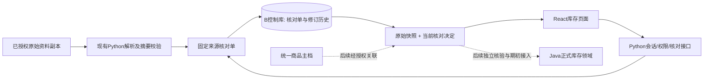

# 库存资料核对与待办处理闭环——完整技术实施计划书

日期：2026-10-13。文档修订：1.0。应用目标：B线v1.1.0。状态：**方案交付、待审阅；尚未实施本方案**。

本方案依据本轮库存页体验审查，解决“发现待核问题后没有下一步”的缺口。它是[总主计划](2026-09-14-current-release-and-java-evolution-roadmap.md#inventory-reconciliation-plan)下的本地资料核对子计划，与[MVP商品接入](2026-10-08-production-order-shipment-mvp-plan.md#production-master-integration-clarification)衔接；实时授权、进度和唯一当前动作仍只维护[执行卡](../../workflow/project-plan-index.md#production-order-shipment-current)。不新建另一套发布、审批或进度体系。

## 1. 目标与交付边界

交付一个真实可保存、可恢复、可更正的本地库存资料核对流程：用户能看到待办、理解原因、补充有依据的信息、预览影响、保存处理结果，刷新后仍可查看，并追溯修改历史。保留用户已认可的产品卡片与颜色×尺码矩阵。

| 本次完整交付 | 后续依赖，明确尚不交付 |
| --- | --- |
| 仓库归属确认、明确不属于本仓、保留待核及更正 | 多仓管理、库区/货架/储位、移库、调拨 |
| 盘点日期及截止说明的记录、更正；允许仍未知 | 正式期初启用、库存结账、盘点盈亏过账 |
| XS至3XL数量补录、明确0、保留未知、核对合计及更正 | 自动推算未知数量、依据旧出货倒推库存 |
| 待办分组、搜索涵盖待确认记录、上下文保留、准确状态与失败恢复 | 将所有来源自动认作同一SKU、跨范围自动建档 |
| 核对记录持久化、权限、事务、版本、幂等及历史 | 入出库流水、可售/可发货库存、订单履约写入 |
| 商品资料完整性与正式SKU关联状态分别展示，给出准确接入前置 | 在本次核对服务内新建商品主档或实现正式SKU绑定 |

“确认”在本页面只表示**确认资料核对决定**，不表示库存过账、商品主档批准或正式业务验收。盘点日期/SKU未知不阻止确认仓库归属，但继续阻止正式库存使用。后续正式库存仍归总计划顺序8。

本次技术计划不要求更换React/Vite、Python框架或MySQL，不安装Redis、消息队列、微服务平台和通用审批引擎。

## 2. 当前实现与已证实问题

实现基准为B工作区`C:/Users/20937/.codex/worktrees/develop-v1-1-0-mvp/CLSEN_Data_Web`，分支`codex/develop-v1.1.0`，HEAD `200469cc94c978035bede3fe60b2a08b11ed163f`加既有未提交实现；实施时重新核对来源，不按旧HEAD覆盖dirty文件。

| 当前依据 | 已核实结论 | 对应方案 |
| --- | --- | --- |
| `InventorySnapshotPage.tsx`、`inventoryPreparation.ts` | 有卡片/矩阵、筛选及依据弹窗；待确认只有查看按钮；主搜索仅涵盖本仓行 | 第3节交互、第8节前端 |
| `backend/app/api/production.py`的GET `/inventory-snapshot` | 只读接口，没有保存归属或补录的命令 | 第6节API、第7节事务 |
| `inventory_snapshot.py` | 原文、摘要、行来源与未知量保留；返回`read_only=true`、`posting_enabled=false` | 保留旧读取合同，新增独立核对决定 |
| `catalog_common.py` | 已有会话、CSRF、站点上下文、admin/data_manager检查 | 复用原权限边界，不新造登录和角色系统 |
| 现有原表草稿 | 使用本地文件及进程内锁保存 | 不将单进程锁照搬成多请求/多进程的核对事务保证 |
| 本轮浏览器与现有测试阅读 | “SKU未关联”旁按钮仅筛款色异常；仓库/库位和真实来源/演练环境标签混用 | 分开状态与操作；补闭环测试，不以展示PASS代替业务完成 |

现有2237件是已归属花都仓库1号的表内汇总；2206的sand 33件、black 12件因空仓库字段单列。此隔离符合现有边界，并非已证实统计错误。用户确认“新仓库”是仓库1号，只确认别名，未据此自动确认空值记录。本方案不代用户作该业务决定。

当前审查证据位于原任务目录`catalog-reference-20261012/inventory-flow-audit-20261013/review.md`。当前浏览器截图为窄屏；实施后仍需核对桌面演示尺寸。

## 3. 用户操作设计

### 3.1 页面结构

继续使用`/production/inventory`，不新建平行“库存系统”。页面显示“本地演示环境／真实来源资料／未过账”，环境标签不再将所有内容统称虚构。日期未知时明确写“盘点日期待确认”。

上方保留本仓产品卡片、颜色尺码矩阵和汇总；汇总标明“本仓资料核对数量”，不能标为当前可用库存。待办区域分为：仓库归属、日期与截止、尺码数量/合计、商品资料缺失、正式SKU接入前置。每组显示本组数量和准确下一步；已解决项可查历史。

术语统一：“仓库归属”负责是否属于花都仓库1号；“库位”留给未来货架/储位。原表列名仍在来源依据中原样保留。

### 3.2 仓库归属处理

1. 用户打开待确认记录，看到款号、颜色、数量、原仓库文本和来源行。
2. 有管理权限时显示“处理仓库归属”；可单条或明确勾选多条处理。选项为“花都仓库1号”“明确不属于本仓”“仍待确认”。本期不伪造其他仓库ID。
3. 填写核对依据/原因。只提示推荐依据，不默认选择归属；不得将空白自动当作“新仓库”。
4. 预览纳入、移出或继续待核的行，以及件数、款数、款色数和待办数的前后变化。批量为全有或全无，一条冲突则整体不保存并列出问题。
5. 点击“保存核对结果”，成功后更新卡片、矩阵、待办和汇总，保留搜索与定位；返回后再次进入仍一致。
6. 可从记录的“更正”进入同一预览流程。更正写新版本，旧记录保留，不用删除历史实现撤销。

“仍待确认”可保存备注，任务仍未解决；“明确不属于本仓”移至“本仓之外”记录组，保留来源，不计本仓量；更正回待核后重新出现在待核组。已由原文明确归属的行也可更正，但同样需依据和影响预览。

条件示例：仅在两条2206均经用户确认属于仓库1号、且其他数据未改变时，预览应为2237→2282件、25→26款、51→53款色、仓库待核2→0条。实际结果服务端按当前版本重算，不能硬编码此示例。

### 3.3 日期与截止

管理者可填写实际盘点日期、库存截止说明和依据；日期字段是业务日期，保存记录时间另用UTC时间戳。10.10整理日期仅作为原始来源信息，不带入实际盘点日期默认值。不知道时可保存“仍待确认”的说明，不能强迫猜日期。

“修改日期”属于有原因的新核对版本；即使日期补齐，系统仍显示SKU/货品状态等未具备条件，不能自动开启过账。精确截止时刻、时区及期初启用规则由以后正式库存接入决定，不能把只有日期的资料当作精确切账时刻。

### 3.4 尺码与合计核对

在已有颜色尺码矩阵进入“核对数量”抽屉，原值与本次确认值并列；允许明确非负整数或“未知”，明确0和未知必须是不同操作。草稿取消不改服务器；多尺码一次预览和保存，避免逐格弹审批。

原表合计、明确尺码和、确认合计分别展示。某尺码补为非零且已知尺码和超过确认合计时，阻止保存该数量变更，提示一并核对合计；全部尺码明确时，确认合计必须等于尺码和。仍有未知尺码时，已知和不得大于确认合计；差额仅标“尚未分配到尺码”，不得自动分摊或补0。已知和等于合计也不自动把剩余未知格改成0。

有可靠合计但尺码不全的记录可继续作为带“尺码未齐”标记的核对数量；正式库存按SKU过账继续受阻。没有可靠合计时仅显示已知数量与未知范围，不宣传完整数量。原公式不执行；人工核对出明确结果可作为带依据的覆盖值保存，公式原文保留。

合计不一致的输入保留在当前编辑表单并逐项提示，整次命令不落库；用户可取消或修正再预览。不默默丢弃失败行，不用“保存成功”掩盖部分失败。

### 3.5 搜索、筛选与商品前置

- 搜索款号/颜色同时覆盖本仓、仓库待核及明确本仓之外三个组，分别显示匹配行数和数量；待核命中不进入本仓汇总。搜索2206应直接显示待核两条，不能单独提示“无产品”。
- 本仓产品仍按整款显示完整颜色和产品数量；另显示筛选结果范围，避免将匹配色小计冒充整款总量。各组使用同一查询条件，本仓产品沿原6条分页；待核/排除记录按必要分页，不静默截断。
- “款号/颜色待补”和“正式SKU未关联”拆开。前者只反映资料缺失，后者准确说明主档接入前置；0条待办不提供误导按钮。
- 本方案不写SKU关联。尚无可用主档处理页时直接说明阻塞与所需资料；有经授权且可用的查询入口时提供带上下文链接，不跳入空的维护页，不假装已提供关联操作。
- 记录使用稳定核对单ID/来源行键定位；搜索、筛选、分页、展开记录进入URL；对话框临时输入留在当前组件状态。刷新恢复已保存结果，未保存修改有离开提示，不在浏览器持久存储真实资料和敏感输入。

### 3.6 保留已确认的展示与数量规则

本次补流程不重做已获用户确认的视觉方案：保留方案1的产品库存查看与方案3的颜色尺码矩阵组合，产品卡片→颜色数量→XS至3XL明细；主销款、旧款号不恢复为默认列或必填项，必要时仅保留来源溯源。颜色尺码直接可见，不能为了新增待办把用户带回只有原表行的列表。

本仓展示沿已有同仓、同款及颜色大小写归组规则，原始来源行仍独立追溯，展示归组不构成主档SKU映射。不同仓库归属或未知归属不得合并进本仓量，颜色同义词不自动合并；补录后按有效行重新聚合，表内合计只计一次，同色多行的尺码含未知时显示已知量及待核情况，不把部分已知量宣称完整库存。聚合范围不混入已替换的旧快照或历史次品。

以本批来源为回归依据：1101只展示NAVY共18件，不混入旧表空仓库的141件；本仓2237件与2206待核45件分开。实际测试使用对应虚构结构，真实数值只用于已授权资料核对；不为凑齐示例修改原始数据。保留搜索整款数量、选中产品、分页与刷新定位，具体合同与第3.5节一致。

## 4. 架构与技术选择



| 层 | 选择与职责 |
| --- | --- |
| UI | 复用React/Vite、现有Dialog/Drawer、FormField、Table、StatusMessage、RequestGate和权限清理机制；不引入新的表格/状态管理框架 |
| API/业务 | 现有FastAPI、Pydantic严格模型、SQLAlchemy事务；Python维护来源资料核对决定，不写订单、发运和库存业务流水 |
| 持久化 | 复用B已有Python控制schema的MySQL，新增最少的核对单与修订表。相较源文件覆写/进程内锁，可提供跨进程事务、并发检查、幂等与历史 |
| 商品权威 | 仍为原Python商品域。本次只保存资料行，`sku_id`未关联状态保持，来源行键不冒充商品ID |
| 正式库存 | 后续Java负责期初/收发事实；不读取核对表后自动扣量，不将Python核对表演进成第二套库存账 |

不新建服务、数据库实例、消息队列或独立仓库主数据系统。新增表迁移先在任务所有的可抛弃MySQL验证；安装到本地真实资料副本属于后续明确部署范围，本计划不执行迁移。

## 5. 数据模型与稳定身份

### 5.1 来源核对单 `production_inventory_reviews`（拟新增）

| 字段 | 含义/约束 |
| --- | --- |
| `review_id` | 服务端生成UUID，API按字符串传递；按项目已有数据库UUID约定落库 |
| `site_id` | 由认证上下文确定，关联现有站点；请求不能自行指定他人站点 |
| `source_identity` | 对来源内容摘要、来源元信息摘要、解析合同版本、核对策略版本作确定性摘要；`UNIQUE(site_id, source_identity)`防止重复建立同一核对单 |
| `source_digest`、`source_manifest_digest` | 原内容SHA256和允许的元信息摘要；保留现有完整性检查，不用文件名或行号单独作为身份 |
| `source_format`、`source_name`、`parser_version`、`policy_version` | 格式和版本固定，后续解析器升级不能悄悄重解释旧单 |
| `source_snapshot_json` | 建单时经过现有解析校验的完整原始展示模型，含原文、数量状态、行键、来源位置、原始日期；作为该核对单不可变基线，不保存密码或无关资料 |
| `revision` | 当前已保存修订号，初始0；所有修改使用预期版本比较 |
| `created_by/at`、`updated_by/at` | 操作身份与UTC时间，服务端填充 |

现有来源大小与行数上限保持，快照JSON只存当前授权格式中的必要核对字段。建单是显式管理操作，GET不创建记录。首次建单只保存基线，不代表所有待核项已确认。revision 0的有效覆盖为空，不写命令修订行；创建人/时间由核对单头记录。核对单增加`UNIQUE(site_id, review_id)`供修订表复合外键引用。

### 5.2 修订与命令回执 `production_inventory_review_revisions`（拟新增）

每次成功变更追加一行；同时承担核对历史和本功能幂等回执，不另建通用事件平台。

| 字段 | 含义/约束 |
| --- | --- |
| `site_id/review_id/revision` | 复合唯一；通过复合外键保证修订与核对单属于同一站点 |
| `operation_id` | 客户端为一次逻辑保存生成UUID；`UNIQUE(site_id, operation_id)`，重复按钮/网络重试复用 |
| `request_hash` | 服务端对规范化命令计算；覆盖核对单、来源身份、预期版本、变化、原因及预览摘要 |
| `command_json` | 本次字段变化，拒绝未知字段、重复行/字段操作和客户端提供的权限/汇总值 |
| `effective_overrides_json` | 本修订完整的资料覆盖值，最多覆盖已存在来源行及允许字段；不复制原表、不重建主档 |
| `result_json` | 当次确认回执，包括已保存版本和前后摘要；幂等重放返回原回执，并标清这是该次操作的结果 |
| `actor_id/at/reason` | 变更人、UTC时间、依据；非空原因，按现有文字上限限制长度 |

索引限定为上述唯一键及核对单版本顺序查询。记录规模目前有限，原始快照一次保存、每版保存覆盖值足够；不提前增加行级物化表或快照压缩。后续出现明确规模问题再按测量调整。

### 5.3 行与字段决定

- 行键为`review_id + source_key`，来源行键在一个核对单内唯一；同款同色的不同来源行仍分别可追溯。
- 仓库决定是`WAREHOUSE_1 / OUTSIDE_SCOPE / UNCONFIRMED`；原始值、人工决定、有效值分开，默认有效值沿现有安全分区规则。
- 尺码决定是`KNOWN(units)`或`UNKNOWN`，数量为0至18位非负整数字符串，服务端整数计算，前端沿BigInt。若汇总超原接口上限，明确报错，不截断/浮点计算。
- 盘点日期与截止说明属于整份核对单；仓库/尺码/合计属于来源行。正式商品身份字段不在可写白名单内。
- 更正可设置新值、设为未知或明确恢复该字段原始值。恢复原值也新增修订，不能回滚整份核对单覆盖其他人已确认内容。
- 新来源摘要建立新核对单，决定不按行号自动搬迁。旧单仍可按固定来源查看和明确更正，但它的修改只影响旧单；新单汇总绝不混入旧单决定。界面必须显示文件/来源身份与版本，不静默把当前打开的旧单切成新单。

## 6. API合同（拟新增，实施后才可调用）

沿`/api/production`与现有会话、CSRF、错误结构。保留GET `/inventory-snapshot`的原只读合同，不将`read_only: true`悄悄改成可写。新页面读取原始快照及相应核对单；旧消费者仍获得原始读取模型。

| 方法与路径 | 用途与关键输入 | 返回/行为 |
| --- | --- | --- |
| GET `/inventory-reviews/current` | 当前已授权来源与当前站点 | 来源身份、已建立的review_id或null、可用能力/初始化前置；不写库 |
| POST `/inventory-reviews` | 明确建立核对单；提交页面看到的source_digest与source_manifest_digest | 服务端重读指定允许来源，核对摘要后冻结解析快照；唯一键保证并发同源只建一单。201新建/200返回同源现有单，重复调用不产生修订 |
| GET `/inventory-reviews/{id}` | 固定核对单 | 原始与有效资料、revision、按组汇总、待办、角色能力；一次响应使用一致版本 |
| POST `/inventory-reviews/{id}/preview` | 来源身份、expected_revision、changes、reason | 无持久化；返回逐项差异、汇总变化、剩余待办与preview_hash。无权限仍拒绝 |
| POST `/inventory-reviews/{id}/commands` | 同一份预览输入与preview_hash；Header `Idempotency-Key` | 原子保存/409冲突/422校验失败；响应返回operation_id、saved_revision与当次汇总 |
| GET `/inventory-reviews/{id}/operations/{operation_id}` | 查询结果不明的原保存操作 | 返回原回执或404；404不能证明正在提交的请求一定失败，后续仍以相同ID/相同内容恢复提交 |
| GET `/inventory-reviews/{id}/history?before_revision=…&limit=…` | 有界历史分页 | 返回操作人、时间、原因、差异与保存版本；读权限/站点隔离与详情一致 |

`changes`仅允许`set_location`、`set_stocktake_date`、`set_cutoff_note`、`set_size_quantity`、`set_reviewed_total`、`restore_source_field`及相应核对备注。命令一次最多100条来源行（日期/截止为单对象），客户端分批时必须明确每批范围；整批全有或全无，不后台静默拆分。空变化直接提示“没有需要保存的变更”，不新建修订。

示意命令（虚构行键，不代表真实确认）：

```json
{
  "source_identity": "<64位摘要>",
  "expected_revision": 2,
  "preview_hash": "<服务端预览摘要>",
  "reason": "依据仓库负责人提供的核对记录",
  "changes": [
    {"type": "set_location", "source_key": "虚构核对表!2", "value": "WAREHOUSE_1"}
  ]
}
```

preview_hash覆盖来源身份、预期版本、策略版本、规范化变化与计算结果，不是独立权限凭证。服务端保存时重新计算，客户端不能直接提交期望汇总让服务器照单全收；发生新版本后必须重新预览，不自动套用旧预览。

权限或资源不匹配沿现有401/403/404语义；业务错误提供中文可执行提示与结构化错误码。至少区分`inventory_review_revision_conflict`、`inventory_review_source_mismatch`、`inventory_review_preview_stale`、`inventory_review_quantity_conflict`、`idempotency_key_reused`及存储不可用。详细错误不包含连接串、绝对私有路径或其他站点资料。

## 7. 保存事务、并发与恢复

保存顺序：

1. 会话、CSRF、站点及管理角色校验；在任何回执重放前仍核对当前访问权限。
2. 开启数据库事务并锁定本站点的核对单行；按当前命令ID查已存在回执。同ID/同内容返回原结果，同ID/不同内容拒绝。重放不因旧expected_revision而误报保存失败。
3. 首次命令检查预期revision、固定来源身份、允许字段与行键；读取当前覆盖版本，重算有效资料和预览摘要，检查合计、未知、范围与批量一致性。
4. 追加修订/回执，将核对单revision加1及更新人/时间，在同一事务提交。任一步失败全部回滚，不能出现历史成功但当前结果没更新。
5. 提交成功后返回已保存版本；页面重新读取该核对单当前结果。如果其他人随后保存，明确展示更新后的版本，不将历史回执汇总冒充最新值。

跨文档相同operation_id由唯一键阻止；唯一约束冲突时回滚并查询既有回执，核对归属与请求摘要后返回原结果或冲突。不用仅进程内Lock替代数据库事务，不在应用启动时自动跑DDL。

单次读取在同一数据库一致性视图中读取核对单及该revision覆盖，避免header版本与内容错位。计数和汇总由同一有效模型生成；搜索仅筛展示，不能改变整份核对单的已确认数量。

超时或断网：保留本次操作ID与输入，显示“结果待确认”，先查询原操作；需要重试也只能用相同ID/内容，不自动换ID重提。页面刷新丢失临时输入时，可从最近历史核对是否保存，不能自动重做未知操作。403撤权后清除敏感状态，不继续展示旧弹窗资料。

409并发冲突：展示已变化的记录/版本，保留用户本次输入供比较，重新读取并由用户确认差异再预览。不能自动覆盖或按最后保存者获胜。不能在失败时降级写本地JSON或浏览器缓存并提示成功。

## 8. 前端与文件职责

| 文件/目录（相对B工作区） | 预计改动 |
| --- | --- |
| `backend/app/production/inventory_snapshot.py` | 保留原读取/解析；提取必要的纯计算复用，禁止扩大原件读取范围 |
| `backend/app/production/inventory_review.py`（拟新增） | 核对模型、字段验证、有效资料计算、预览与事务保存；实现复杂时再拆repository，避免预建通用层 |
| `backend/app/api/production.py` | 新核对路由，复用CatalogReadContext、CatalogWriteContext、CatalogEngine和require_catalog_manager |
| `backend/alembic/versions/`中的下一条合法迁移 | 两张核对表、唯一/外键与适用权限；迁移号在实施时按实际head确定，更新既有schema/权限合同涉及项 |
| `frontend/src/features/production/InventorySnapshotPage.tsx` | 双来源显示（原始/核对后）、待办、搜索分组、能力前置、历史入口与刷新状态 |
| `frontend/src/features/production/InventoryReviewDialog.tsx`（拟新增） | 仓库、日期、数量编辑与统一预览/结果/冲突恢复；保留原只读依据入口 |
| `frontend/src/features/production/inventoryPreparation.ts` | 分开资料缺失与SKU前置，三个来源组搜索，纯计算测试；不依据display key建立SKU |
| `frontend/src/features/production/Production.module.css` | 沿原设计tokens补编辑与预览状态，复用产品卡片/矩阵，不另做视觉改版 |
| `frontend/src/app/WorkspaceShell.tsx`的实际标签来源及生产页范围说明 | 只修受影响页面的环境/资料状态表达；查清数据来源后再改，不能把全站标签硬改成真实业务 |
| 现有请求客户端/RequestGate/权限清理机制 | 优先复用；如需新增本功能DTO与调用函数，放在production目录，不引入全站新请求框架 |

界面状态至少包括：未初始化、只读用户、有可处理待办、编辑未保存、预览可保存、保存中、成功、结果不明、版本冲突、来源不匹配、权限变化和存储不可用。按钮按能力显示并说明原因；只有前端隐藏不构成安全控制。

键盘要求：输入有标签，错误关联到字段；对话框焦点正确，Escape取消未提交编辑需适当提示，关闭返回原触发点；保存成功或冲突提供可感知反馈。桌面演示尺寸和当前窄屏都要覆盖，尺码矩阵横向查看不遮住保存操作。

## 9. 权限、来源与兼容性

- viewer仅查看来源、当前核对结果与允许的历史。admin/data_manager可建立核对单、预览、保存及更正；沿现有角色，不新增独立多级审批。权限在API服务端执行，读取回执也不能绕过站点隔离。
- 环境沿现有B本地启用条件与明确来源路径；本次不开放任意文件路径、跨站点来源或公网上传端点。
- 读取不自动建单；首次进入显示“尚未开始资料核对”，管理者显式开始后形成revision 0。开始操作重复/并发按来源唯一键返回同一单，不重复复制基线。
- 原快照及主档读取API保持兼容，新核对DTO与来源DTO分开。旧页面URL仍能打开；新增review/record参数缺失时解析当前授权来源，非法参数给出可恢复提示。
- 修改来源文件不是更正入口。保存核对决定只依赖该核对单已冻结来源与明确版本，不重读可变原文件后重新解释旧行；新资料必须经过原读取摘要校验后建立新单。来源变化提示不自动携带旧决定。
- 不修改Python商品主档表、A副本或Java订单/出货数据库；后续绑定SKU由主档权威和有效版本合同负责。

## 10. 测试与验收合同

实施前保留快照和既有dirty成果；使用虚构资料与任务所有的可抛弃MySQL完成会改变状态的开发验证。先走通本次完整路径，再做与风险对应的必要自动检查。真实资料副本中的保存体验须有明确范围，不能为测试代用户确认真实归属。

| 场景 | 必须得到的结果 |
| --- | --- |
| 原只读功能与初始化 | 原快照仍可读；GET不新增记录；首次/重复/并发建单只有同源一单 |
| 仓库完整路径 | 待核→预览→确认→本仓汇总→刷新→历史→更正回待核，数量变化准确且历史保留 |
| 明确本仓之外 | 从待核消除，但仍能搜索/查看，不进入本仓汇总；可有依据更正 |
| 未知/0及合计 | 空白、斜杠、明确0分别保存；不执行公式，不自动补齐；不一致数量拒绝整次保存 |
| 日期 | 整理日不自动当盘点日；保存、更正、清除为未知可追溯，UTC记录时间与业务日期区分 |
| 搜索与待办 | 待核产品可搜到，各组分开；0条款色异常不引导空操作；SKU未关联准确说明前置 |
| 重复提交/结果未知 | 同ID相同命令只产生一个修订；不同内容拒绝；提交后响应丢失可找回回执 |
| 并发与事务 | 同版本两次竞争只有一次成功，另一次409；中途故障不留下半份结果/孤立历史 |
| 权限/跨站点 | viewer写入拒绝、CSRF缺失拒绝、他站review/操作ID不可访问，撤权清理旧敏感展示 |
| 来源替换与历史 | 新来源新单，旧行号决定不套入新表；旧单读取不受新解析器默认规则改变 |
| 边界及批量 | 行数/文本/数量/批量上限明确拒绝；全有或全无；不静默丢记录或显示假零 |
| 实际展示 | 桌面与窄屏正常操作；焦点/错误/保存状态清晰；改资料不改变Java订单履约与正式库存 |

优先复用`backend/tests/unit/test_production_readonly_snapshots.py`、`frontend/src/features/production/InventorySnapshotPage.test.tsx`及原生产权限/路由测试。对新增事务与幂等补目标MySQL集成测试，计算补纯单元测试；数据持久化和跨进程并发不能只用mock证明。Storybook只新增受影响编辑/冲突/结果不明等虚构故事，禁止真实资料进入故事。

检查按[验证策略](../../operations/development-verification-policy.md)选择：后端目标节点、前端受影响交互，必要类型/lint/token/构建，限定UI可访问性与视觉场景；预算遵循普通快检/数据库检查规定。没有新失败不重复全跑；正式Collect、全量发布门禁及远端CI在对应授权时执行。

开发完成的硬标准：仓库、日期、数量三条承诺的处理路径均可保存/刷新/更正，历史与权限正确；没有只展示成功提示的假闭环。尚不提供SKU绑定与正式库存能力要清楚展示，不算本期未兑现功能。

## 11. 实施任务与依赖

| 任务 | 工作与依赖 | 可审阅结果 |
| --- | --- | --- |
| 一：核对存储与仓库处理闭环 | 核对B源码/迁移/权限；实现固定来源单、修订、预览/命令API及仓库编辑；在可抛弃环境走通 | 能用虚构待核记录完成确认、刷新、历史和更正，覆盖权限、重复提交、并发与回滚 |
| 二：日期/数量和统一待办 | 复用任务一同一命令机制，补日期、截止、尺码与合计；修搜索、状态和标签 | 完成本方案承诺的资料核对路径，所有待办都有可执行处理或准确外部前置 |
| 三：本地完整验证与老板演示准备 | 复用有效自动检查，桌面/窄屏走通；按明确授权安装到演示副本并准备来源/账号/操作说明 | 可连续演示真实来源与本地核对结果；未明确真实归属时保留待核，用独立虚构夹具演示确认，不伪造真实事实 |
| 后续：正式主档与库存接入 | 沿原顺序7的身份覆盖/绑定及顺序8的期初与流水条件 | 只消费明确版本的核对结果；另行确认日期、SKU、货品状态、期初范围与未结单据，不重复计旧出货 |

老板演示的真实来源、假设装箱资料和虚构业务操作的区分统一维护于[MVP演示安排](2026-10-08-production-order-shipment-mvp-plan.md#boss-demo-path)。本方案补齐资料待核操作，不独自解决生产商品身份及真实订单/出货的接通；演示脚本不能越过这些前置。

任务一/二是同一完整交付中的实现顺序，不要求逐文件、逐接口或每次保存向用户审批，也不能完成仓库按钮后就宣称整套计划完成。当前仅请求计划书；批准实施后按授权连续推进，具体真实事实确认与扩大数据范围另按缺口处理。

不承诺未经验证的固定工期。任务一完成后可依据实际迁移/接口复用情况给出剩余工作估计；如老板演示日期明确，优先保证承诺的完整路径与真实状态表达，不用修改标签掩盖缺失功能。

## 12. 迁移、安装、回退与后续发展

数据库迁移为新增表/约束，不修改原业务表和原件。先核对实际Alembic head，沿项目migrator、TLS、账户及schema合同执行；测试schema由任务持有，应用账号不获DDL。安装到B体验控制库前列明目标与备份/恢复方式，不能把批准文档当迁移授权。

部署采用新增接口兼容旧快照读取；页面只在新接口及所需schema具备时开放编辑，失败给出明确未启用原因，不吞错退回只读却宣称可编辑。回退关闭新写入并恢复原只读入口，已保存核对记录保留；不自动drop表、删除历史或把本地副本覆盖服务器。

未来正式库存导入必须显式选定review_id与revision，对SKU、日期/截止、仓库、货品状态及数量再次核验，用单独期初业务操作ID防重。来源核对单被更正后不能静默改已过账库存；需形成新差异并走库存领域更正。资料核对与库存过账始终保持不同写入责任和操作语义。

备份范围在后续安装时加入新增核对表，实际恢复能力到对应发布/运维阶段验证；本次不新建备份平台或运行全套恢复演练。

## 13. 需要的业务决定与授权边界

| 待明确项 | 当前处理 | 何时需要 |
| --- | --- | --- |
| 两条2206是否属于花都仓库1号 | 继续待核，不凭仓库别名推断 | 真实资料中保存归属时由有依据的业务人员确认 |
| 实际盘点日期/截止 | 未知，保留整理日期原文 | 真实日期补录及以后正式期初启用前 |
| 空白、斜杠及尺码合计的真实含义 | 继续未知，不补0 | 补录对应字段时；不阻止仓库处理开发 |
| 正式SKU及来源scope | 本方案不绑定、不新建竞争主档 | 原主档接入任务完成并具备确认合同后 |
| 真实副本的核对写入/迁移 | 本次只规划；开发先用任务可抛弃数据 | 后续安装及真实演示保存的授权范围中明确 |

以上决定不阻止用虚构数据实现并验证本方案，也不要求现在逐项问齐。不扩大原件读取、不访问项目`data/`、不自动恢复整库或连接服务器；提交、push、merge和发布按既有边界。

## 14. 交付物与状态口径

实施交付包括：必要迁移与后端命令、库存页完整处理路径、目标测试与结果、可用本地入口、账号获取方式、资料范围、3–5步演示说明和未完成前置。更新同一执行卡与原任务README，不另建审批台账。

`development_complete`要求本方案已实现且开发验证完成；`ready_for_user_review`要求环境、角色、来源和数据前置已齐备；`user_verified`仅按用户实际确认的版本/范围记录；`release_validation`及正式发布单独处理。现有库存卡片展示的用户确认继续有效，但不能替代本次待核处理验收。

本计划书使用writing-plans主流程编制，已核对现行代码与审查结果。编制过程仅修改计划/导航，未实施接口、建表、确认真实归属或运行迁移。
